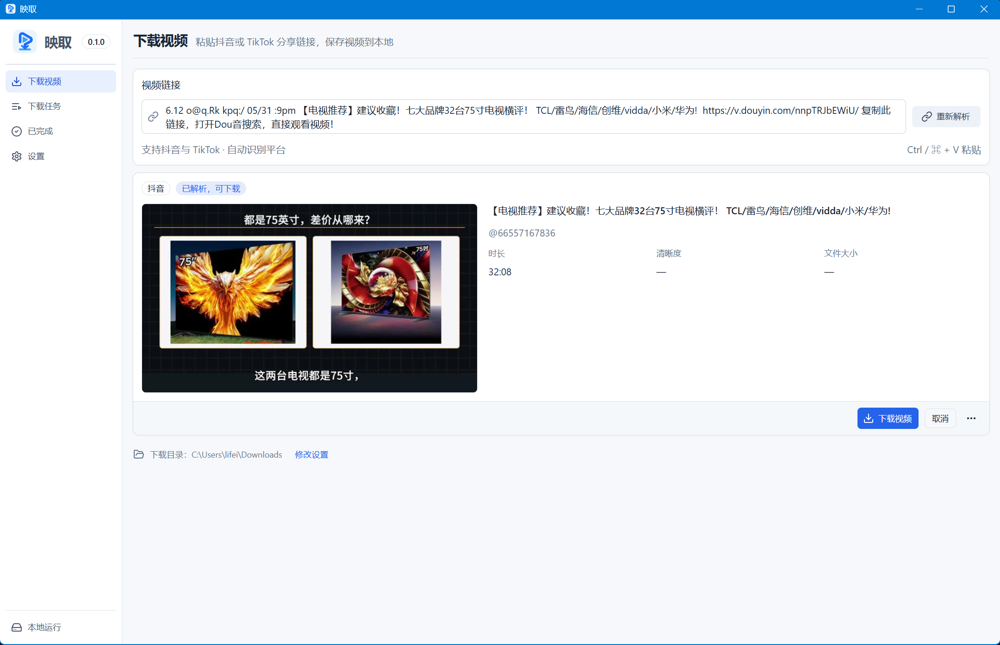

  

<h1 align="center">映取 · 把喜欢的视频，留在本地</h1>

一款支持抖音、TikTok 与 YouTube 的轻量桌面视频下载器。 粘贴分享文案，预览作品，保存视频、封面和图集。

  <a href="https://github.com/lifei6671/video-downloader/releases">查看发行版本</a> ·
  <a href="#三步保存一个视频">快速上手</a> ·
  <a href="https://github.com/lifei6671/video-downloader/issues">反馈问题</a> ·
  <a href="docs/development.md">开发文档</a>

## 从分享链接，到你的本地收藏

看到值得留下的视频，不必再从一长段分享文案里挑出链接。把整段内容粘贴到映取，确认作品后开始下载；视频、封面和完成记录，都可以在本机查看。

映取把常用操作放在一个紧凑的桌面窗口里：下载进度一眼可见，遇到失败可以重试，找文件直接打开所在位置。收起窗口后，让下载继续进行。

## 为日常收藏准备的功能

| 功能 | 带来的便利 |
| --- | --- |
| **抖音、TikTok 与 YouTube** | 支持三平台单条视频；抖音与 TikTok 另支持图集，也能从分享文案中提取链接。 |
| **可复用解析缓存** | 相同作品优先读取 SQLite，重启恢复封面与图集预览；下载时重新获取有效媒体地址。 |
| **先预览，再下载** | 查看标题、作者、封面或图集图片、尺寸和来源，确认后再保存。 |
| **原图优先的图集下载** | 原图未提供时选择高清，保留 WebP/JPEG 等原格式；可从完成记录查看本地图集。 |
| **视频与封面一起保存** | 下载平台可用的最高分辨率封面，在已完成列表中快速辨认作品。 |
| **并发下载与等待队列** | 默认同时下载 2 个，可调整为 1–3 个，后续任务自动排队。 |
| **重复下载提醒** | 识别到已有成功下载记录时，先询问是否重新下载；新文件不会覆盖旧文件。 |
| **本地记录管理** | 在下载任务中按标题或作者搜索记录、打开已完成作品的文件位置；移除记录与删除本地作品分开操作。 |
| **托盘与单实例** | 关闭窗口收起到托盘，任务继续运行；再次启动会回到已有窗口。 |
| **分平台配置** | 三平台分别设置 Cookie、代理和 User-Agent；未填 Cookie 时尝试系统默认浏览器。 |

## 三步保存一个视频

1. **配置一次。** 在设置中选择下载目录，按需填写对应平台的 Cookie 和代理。
2. **粘贴并解析。** 复制视频分享链接或整段分享文案，粘贴到“下载视频”，点击“解析链接”。
3. **确认并下载。** 查看预览后开始下载，在“下载任务”统一查看进度、完成记录和本地文件位置。

YouTube 解析需要 Node.js 22+ 或 Deno 2.3+；高清音视频合并使用 FFmpeg。Telegram 视频完整下载后也会通过 FFmpeg 抽帧生成封面，在前 30 秒内采样并跳过近乎全黑的画面；封面只写入已有 SQLite 缓存供应用展示和重启恢复，下载目录不生成封面图片；移除最后一个引用任务时清理封面缓存，保留解析元数据。缺少 FFmpeg 或抽帧失败不影响视频下载成功。这些工具不随安装包内置，可在“系统设置 → 运行依赖”检测，并下载缺失工具到应用专属目录；系统已有可用版本会直接使用，自定义目录可加入 PATH。浏览器 Cookie 可能受数据库占用或系统加密限制，失败时可在设置手动粘贴。详见 [YouTube 与本机工具说明](docs/youtube-validation.md)。

Telegram 提供默认关闭的 **tdl HTTP 实验模式**：自行安装 tdl（不绑定版本），软件自动执行 `tdl version` 检测，并在“运行依赖”显示版本与路径；支持 PATH、GOBIN、GOPATH/bin 及 Go 配置目录，在“运行依赖”也可手动检测并配置路径，在“平台账号 → Telegram”阅读风险并启用后，可解析和下载单条消息的原始视频，复用全局队列与本地记录。下载中可继续通过同一 tdl 服务解析其他消息；已确认的频道用户名映射从已有解析缓存跨消息复用；新用户名频道在服务占用时可点击“加入待下载队列”，服务空闲后自动解析并下载，不新增登录会话。平台账号中的“登录 tdl”在弹窗内显示二维码并输入两步验证密码，由隐藏伪终端中的官方 tdl 完成认证；密码仅临时传递、不保存。每次创建独立会话，不覆盖现有登录。tdl 的服务会监听所有接口，缺少令牌及消息范围限制；访问 127.0.0.1 不能提供网络隔离，请仅在可信网络中使用并通过系统防火墙限制外部访问。映取不分发 tdl、不导入现有会话、不转码。使用范围、来源与验证边界见 [tdl 集成说明](docs/tdl-integration.md)。

想暂时收起窗口，点击关闭即可隐藏到托盘。需要结束运行时，选择托盘菜单中的“退出映取”；应用会先停止任务并回收下载进程。

## 下载与项目状态

前往 [GitHub Releases](https://github.com/lifei6671/video-downloader/releases) 查看可用版本和对应说明。若暂无适合你的安装包，可以按[开发文档](docs/development.md)从源码运行。

项目目前处于早期迭代阶段：

- **Windows：** 已完成开发环境下的双平台真实下载验证及安装包构建；全新、未安装 Python 的系统验收仍待完成。
- **macOS：** 已完成 Apple Silicon 本机 `.app` / `.dmg` 构建、双平台 GUI 预览下载、本地封面、完成记录及正常重启恢复；声明最低系统版本 13.3，Intel、旧系统及其他验收场景仍待完成，见 [macOS 验证记录](docs/macos-validation.md)。
- **签名：** Windows 代码签名尚未配置；macOS 采用本地 ad-hoc，按当前项目决定不要求 Developer ID、证书或公证。

安装包按包含下载引擎的方式构建；具体平台是否可用，以对应 Release 的产物和验收说明为准。

## 数据留在本机，设置由你掌握

下载文件和历史记录保存在本机，不需要注册映取账号。应用直接访问对应平台获取作品，不提供云同步。

Cookie 按当前设计直接存储在本机 SQLite 数据库，并可在设置中回显；含密码的代理使用系统凭据存储。不要分享 Cookie 或包含凭据的本地数据库。

## 当前支持范围

映取支持**单条视频与图集的解析、下载和本地管理**。视频默认 yt-dlp，图集自动使用 DTK，也可明确选择解析引擎。图集原图优先、高清次选，保留平台图片格式，不转码；下载到独占目录，完成后可查看图集。暂不支持作者批量采集、直播、平台内容搜索、转码或断点续传。失败后重试会重新解析并从头下载，退出后的未完成任务不会自动续传。

平台接口、Cookie 和网络环境会影响解析与下载结果。封面获取失败时，已成功下载的视频仍会保留。请仅下载你有权保存和使用的内容。

## 一起让映取更好用

使用中遇到问题，欢迎[提交 Issue](https://github.com/lifei6671/video-downloader/issues)，附上应用版本、系统、操作步骤和已脱敏的错误信息。如果映取对你有帮助，欢迎点一个 Star，也欢迎通过 Pull Request 参与改进。

技术栈：**Tauri 2 · React · TypeScript · Rust · SQLite · yt-dlp**。

[开发与发布指南](docs/development.md) · [技术方案](docs/tauri-desktop-technical-plan.md) · [验收记录](docs/README.md) · [第三方来源与声明](vendor/UPSTREAM.md) · [开源许可证](LICENSE)

双引擎来源与升级流程见 [DTK 接入方案](docs/dtk-dual-engine-plan.md)，实际验收见 [双引擎与图集验证](docs/dual-engine-validation.md)。
