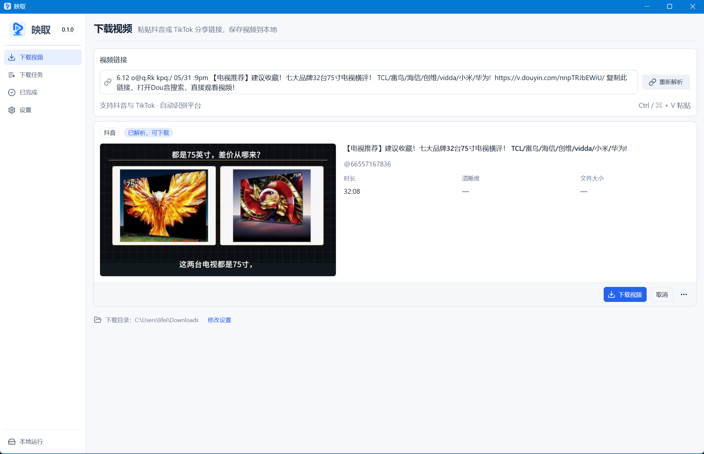

  

<h1 align="center">映取 · 把喜欢的视频，留在本地</h1>

一款支持抖音、小红书、TikTok、YouTube 与 Telegram 的桌面视频下载器。 粘贴分享文案，预览作品，保存视频、封面和图集。

  <a href="https://github.com/lifei6671/video-downloader/releases">查看发行版本</a> ·
  <a href="#三步保存一个视频">快速上手</a> ·
  <a href="https://github.com/lifei6671/video-downloader/issues">反馈问题</a> ·
  <a href="docs/development.md">开发文档</a>

## 从分享链接，到你的本地收藏

看到值得留下的视频，不必再从一长段分享文案里挑出链接。把整段内容粘贴到映取，确认作品后开始下载；视频、封面和完成记录，都可以在本机查看。

映取把常用操作放在一个紧凑的桌面窗口里：下载进度一眼可见，遇到失败可以重试，找文件直接打开所在位置。收起窗口后，让下载继续进行。

## 为日常收藏准备的功能

| 功能 | 带来的便利 |
| --- | --- |
| **抖音、小红书、TikTok、YouTube 与 Telegram** | 支持单条视频；抖音、小红书与 TikTok 另支持图集，也能从分享文案中提取链接。 |
| **微信视频号（实验功能）** | 支持单条 `weixin.qq.com/sph/` 视频。需要登录时，在「系统设置 → 平台账号 → 微信视频号」扫码登录腾讯元宝，也可手动填写元宝网页 Cookie。下载校验使用 FFmpeg 和 FFprobe。详见[实测记录](docs/weixin-channels-probe-results.md)。 |
| **个人云端备份与资料库** | 将视频、封面和文案备份到自有 R2、S3 或 Telegram 私有频道；按需恢复视频，也可确认备份后释放本机空间。 |
| **可复用解析缓存** | 重启可恢复已保存的预览；下载时重新获取媒体地址。小红书粘贴新链接时会重新解析分享参数。 |
| **先预览，再下载** | 查看标题、作者、封面或图集图片、尺寸和来源，确认后再保存。 |
| **图集下载** | 抖音、TikTok 原图优先并保留原格式，小红书保存高清 JPEG；可从完成记录查看本地图集。 |
| **封面预览与导出** | 封面保存在本机缓存供列表展示；支持大图预览、右键保存和复制图片，抖音优先使用原始设计封面。 |
| **视频文案提取** | 已下载视频使用 Fun-ASR-Nano 提取文案、复制或导出 TXT；支持 CPU 与 Windows 可选 CUDA 加速，模型和组件按需下载，无需另装 Python 或 CUDA Toolkit。 |
| **并发下载与等待队列** | 默认同时下载 3 个，可调整为 1–5 个，后续任务自动排队。 |
| **重复下载提醒** | 不同视频规格可分别下载；同规格已有成功记录且文件仍存在时先询问，重新下载不覆盖旧文件。规格未知的旧记录保守提示。 |
| **本地记录管理** | 按平台筛选、搜索和清理任务，打开已完成作品的文件位置；从列表移除保留文件，删除本地作品同步移除下载记录。 |
| **托盘与单实例** | 关闭窗口收起到托盘，任务继续运行；再次启动会回到已有窗口。 |
| **分平台配置** | 按平台配置账号和网络；抖音、小红书、微信视频号、TikTok、YouTube 分别设置 Cookie、代理和 User-Agent，Telegram 使用内置扫码登录。 |

## 三步保存一个视频

1. **配置一次。** 在设置中选择下载目录，按需填写对应平台的 Cookie 和代理。
2. **粘贴并解析。** 复制视频分享链接或整段分享文案，粘贴到“下载视频”，点击“解析链接”。
3. **确认并下载。** 查看预览后开始下载，在“下载任务”统一查看进度、完成记录和本地文件位置。

小红书支持网页分享链接和 App 短链，默认匿名解析。遇到访问限制时可在“系统设置 → 平台账号 → 小红书”使用内置登录或手动填写 Cookie。图文保存不带平台水印的 CDN 高清 JPEG，实况照片还会保存同编号的 MP4，并可在完成后的图集中播放。

YouTube 解析需要 Node.js 22+ 或 Deno 2.3+；高清音视频合并使用 FFmpeg。Telegram 视频完整下载后也会通过 FFmpeg 抽帧生成封面，在前 30 秒内采样并跳过近乎全黑的画面；封面只写入已有 SQLite 缓存供应用展示和重启恢复，下载目录不生成封面图片；移除最后一个引用任务时清理封面缓存，保留解析元数据。缺少 FFmpeg 或抽帧失败不影响视频下载成功。这些工具不随安装包内置，可在“系统设置 → 运行依赖”检测，并下载缺失工具到应用专属目录；系统已有可用版本会直接使用，自定义目录可加入 PATH。YouTube 可从平台账号设置打开系统浏览器登录，并在设置中手动粘贴站点 Cookie。详见 [YouTube 与本机工具说明](docs/youtube-validation.md)。

Telegram 单条消息的原始视频由内置 Rust grammers SDK 直接解析和下载，无需安装 tdl。在“系统设置 → 平台账号 → Telegram”扫码登录，可复用 Telegram 存储账号授权；下载复用全局队列、并发、单任务取消和本地记录，不转码。支持范围和验证边界见 [Telegram 下载](docs/telegram-download.md)。

想暂时收起窗口，点击关闭即可隐藏到托盘。需要结束运行时，选择托盘菜单中的“退出映取”；应用会先停止任务并回收下载进程。

## 下载与项目状态

前往 [GitHub Releases](https://github.com/lifei6671/video-downloader/releases) 查看可用版本和对应说明。若暂无适合你的安装包，可以按[开发文档](docs/development.md)从源码运行。

项目目前处于早期迭代阶段：

- **Windows：** 已完成开发环境下的双平台真实下载验证及安装包构建；全新、未安装 Python 的系统验收仍待完成。
- **macOS：** 已完成 Apple Silicon 本机 `.app` / `.dmg` 构建、双平台 GUI 预览下载、本地封面、完成记录及正常重启恢复；声明最低系统版本 13.3，Intel、旧系统及其他验收场景仍待完成，见 [macOS 验证记录](docs/macos-validation.md)。
- **签名：** Windows 代码签名尚未配置；macOS 采用本地 ad-hoc，按当前项目决定不要求 Developer ID、证书或公证。

安装包按包含下载引擎的方式构建；具体平台是否可用，以对应 Release 的产物和验收说明为准。

## 数据留在本机，设置由你掌握

下载文件和历史记录保存在本机，不需要注册映取账号。应用直接访问对应平台获取作品；可选的云端备份使用你自己的 R2、S3 或 Telegram 私有频道，映取不提供托管云服务。配置与使用范围见[云端备份说明](docs/multi-device-sync-operations.md)。

Cookie 按当前设计直接存储在本机 SQLite 数据库，并可在设置中回显；含密码的代理使用系统凭据存储。不要分享 Cookie 或包含凭据的本地数据库。

## 当前支持范围

映取支持**单条视频与图集的解析、下载和本地管理**。视频默认 yt-dlp，图集自动使用 DTK，也可明确选择解析引擎。图集原图优先、高清次选，保留平台图片格式，不转码；下载到独占目录，完成后可查看图集。暂不支持作者批量采集、直播、平台内容搜索、转码或断点续传。失败后重试会重新解析并从头下载，已提交但中断的下载会在重启后按原顺序重新排队，从头下载，不提供跨重启断点续传。

平台接口、Cookie 和网络环境会影响解析与下载结果。封面获取失败时，已成功下载的视频仍会保留。请仅下载你有权保存和使用的内容。

## 一起让映取更好用

使用中遇到问题，欢迎[提交 Issue](https://github.com/lifei6671/video-downloader/issues)，附上应用版本、系统、操作步骤和已脱敏的错误信息。如果映取对你有帮助，欢迎点一个 Star，也欢迎通过 Pull Request 参与改进。

技术栈：**Tauri 2 · React · TypeScript · Rust · SQLite · yt-dlp**。

[开发与发布指南](docs/development.md) · [技术方案](docs/tauri-desktop-technical-plan.md) · [验收记录](docs/README.md) · [第三方来源与声明](vendor/UPSTREAM.md) · [开源许可证](LICENSE)

双引擎来源与升级流程见 [DTK 接入方案](docs/dtk-dual-engine-plan.md)，实际验收见 [双引擎与图集验证](docs/dual-engine-validation.md)。
