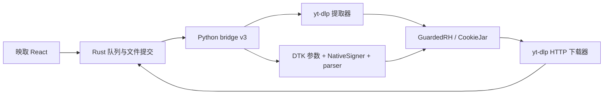

# 双解析引擎与图集实现

日期：2026-10-14。按用户正式接入决定，应用采用 yt-dlp + Evil0ctal DTK 双解析引擎，并支持单作品图集 GUI 下载。原图优先、高清次选，保留网络响应的格式与字节，不转码。运行与验收结果见 [双引擎验收](dual-engine-validation.md)。此前“仅 yt-dlp / 不含图集”的范围决定已被本次明确要求覆盖。

## 架构与边界

一个 Python sidecar，共用网络与下载器，Rust 保持任务唯一状态源。



默认按展开后的作品类型选择：视频走 yt-dlp，Douyin `/note/` 和 TikTok `/photo/` 图集走 DTK。解析表单允许明确选择 yt-dlp 或 DTK；失败不静默切换。DTK 视频 streams 映射到共用单文件下载路径，仍拒绝分轨合并、转码或非直接 HTTP(S) 媒体。

DTK 固定 5.1.3 / `4f0bed8483c35a980315d9c7b3a1d4a1119ad2b2`。复用平台参数和 parser、内容模型、错误类型、NativeSigner 及其依赖的 31 个 Python 文件，完整白名单、逐文件原始和安装后 SHA-256 见 [manifest](../vendor/dtk/manifest.json)。不引入上游 UI、FastAPI、PostgreSQL、Redis、身份池、浏览器 RPC、wreq 或监听端口。

自有 `python-engine/dtk_adapter.py` 调用顺序：

1. 平台 `profile_for` 根据 UA 构造参数，当前使用 Win32/MacIntel 与 1920×1080 基线，不声称模拟真实 TLS 浏览器指纹。
2. `build_request` 构造单作品详情请求，`NativeSigner(..., fill_ms_token=False)` 使用授权 Cookie 的 SigningSession；不生成游客身份。
3. 签名 query 按原字节经既有 GuardedRH 请求，使用同一 CookieJar 与分平台代理快照；保留逐跳目标、直连 DNS 和私网约束。
4. 调用上游 `parse_content`，自有适配仅返回白名单元数据。raw、Cookie 和签名媒体地址不进入任务事件、日志或 SQLite。

必要运行依赖 pydantic 2.14.1、structlog 26.1.0、httpx 0.28.1 及其传递依赖锁定在生产清单。httpx 是 token 模块的导入依赖，不承接详情或媒体请求。structlog 自由文本在 bridge 中全部丢弃；stdout 只输出协议。

## 图片质量和原格式

按每张图片选择平台明确提供的原图；缺原图时使用详情中的高清路径。Douyin `original_images` 已存在时严格核对结构和图片对应关系，不认识或错误的字段形状明确失败。原图 URL 仅在 HTTP 404/410 时降为该图片的高清资源；401/403、风控、网络错误不会被当作原图不存在。TikTok 当前验证字段提供高清资源，未来上游新增原图字段需审核适配后接入，不猜字段或地址。

禁止拼接“原图”模板、改写 CDN query 或使用水印 `download_url_list`。预览使用高清图片，下载使用独立选择的候选；下载后以实际 `quality_source` 和尺寸更新记录。下载内容经 HttpFD 保存，文件头决定 JPEG/PNG/WebP/GIF/AVIF/HEIC 后缀，不截图、不缩放、不重压缩。

当前真实样本：

- 抖音 `7687900413543421811` 的 `original_images` / `image_list` / `image_infos` 为 null；返回 `images.url_list` 高清资源，保存 6 张 WebP。2160×3240 只能证明分辨率，不能证明原始上传文件。
- TikTok `7690209438195633416` 的每项仅有 `imageWidth`、`imageHeight`、`imageURL`；保存 3 张 JPEG，1784×2396、1812×2396、1820×2396。
- 两个样本全部如实标记“高清”。原图优先、404/410 降级和身份错误不降级已通过离线业务回归；真实原图候选的在线验证 `UNAVAILABLE`。

## 图集任务契约

每个任务保存实际 `resolver` 和 `kind`；下载获得槽位后使用同一配置快照与 resolver 重新提取，核对平台、作品 ID、类型与张数。手动重试新建任务并重新解析，保持实际 resolver。旧记录缺字段按 yt-dlp/video 解释。

协议 v3 握手严格核对引擎 0.3.0、yt-dlp 版本和 DTK manifest 的 commit/version。解析返回图片尺寸、来源与 Rust 所拥有预览目录内的相对文件名；前端调用 `get_task_image` 读取本地字节，不接收签名图片地址。

图集占一个下载槽位，图片依次写入该任务的暂存目录，保留 `.part`。进度汇总已下载字节和完成张数；尚未取得全部准确大小时总量未知，显示不确定进度，不生成假百分比。解析大小未知仍显示“—”。

成功结果包含每张图片的安全相对名称、实际 bytes、SHA-256、尺寸和来源。Rust 核对真实目录、文件数量、编号、类型、大小及 hash，在 commit_intents 保存清单后以不覆盖的原子目录移动发布为 `平台_作品ID_任务ID/001.webp` 等。引擎正常退出、文件验证和数据库提交完成后才标 completed；预览、暂存和 `.part` 随进程回收清理。

已完成列表提供本地图集查看器，重启后仍从文件和保存的清单读取。提交意图恢复只有在完整目标清单与 hash 一致时认定完成；未完成任务按既有规则中断，不称为断点续传。从列表移除只删记录；二次确认删除本地图集只删该任务清单中的文件，用户另放的文件保留。

## 上游同步与补丁升级

[desktop-imports.patch](../vendor/dtk/patches/desktop-imports.patch) 仅修改 signing 包初始化，移除不用的 registry/RPC 聚合导入；签名算法、参数及 parser 保留上游原文。Apache LICENSE/NOTICE 保存于 upstream 并随 sidecar 分发。该补丁只适用于桌面切片，不用于全量上游服务。

`scripts/update_dtk_vendor.py` 已实现：固定完整 SHA 读取原始 git blobs → 校验原始 hash → staging 中 apply --check 和应用独立 patch → 审计导入闭包和语法 → 一并替换源目录、manifest 与生成 revision。离线 `--check` 校验已安装内容、补丁、白名单与版本；未知依赖、补丁冲突和本地源码修改保留原安装内容，明确失败。

```sh
.venv/bin/python scripts/update_dtk_vendor.py --check
.venv/bin/python scripts/update_dtk_vendor.py --source /path/to/upstream
.venv/bin/python scripts/update_dtk_vendor.py --ref <完整40位SHA> --update
```

新 SHA 和补丁必须审核；依赖或文件闭包变化由人工明确更新 manifest/锁文件，不自动搬入整套上游。CI 和 Release 执行固定版本离线校验。升级后运行解析、图片质量、文件、协议、取消/恢复回归，双平台真实视频/图集冒烟及各目标安装包验收；然后随完整应用更新。运行时不拉 main、不热替换模块。详细命令见 [开发文档](development.md#解析模块同步与补丁升级)。

## 初始独立试验证据

正式接入前使用 `.local/dtk-trial-venv` 和最小白名单切片完成四类内容解析、9 张图片 HttpFD 下载及 sips 尺寸读取。当时 GUI、多文件提交、重启和正式打包均 `NOT_RUN`；该阶段结果不能替代本次正式应用验收。上游 parser fixtures 为手工构造，离线回放不能代表在线能力。旧 prototype manifest/patch 已由正式 vendor 取代。

## 上游依据

- [固定 commit](https://github.com/Evil0ctal/Douyin_TikTok_Download_API/tree/4f0bed8483c35a980315d9c7b3a1d4a1119ad2b2)
- [平台适配契约](https://github.com/Evil0ctal/Douyin_TikTok_Download_API/blob/4f0bed8483c35a980315d9c7b3a1d4a1119ad2b2/src/dtk/platforms/base.py)
- [Douyin parser](https://github.com/Evil0ctal/Douyin_TikTok_Download_API/blob/4f0bed8483c35a980315d9c7b3a1d4a1119ad2b2/src/dtk/platforms/douyin/parser.py)
- [NativeSigner](https://github.com/Evil0ctal/Douyin_TikTok_Download_API/blob/4f0bed8483c35a980315d9c7b3a1d4a1119ad2b2/src/dtk/signing/native/signer.py)
- [手工 fixture 说明](https://github.com/Evil0ctal/Douyin_TikTok_Download_API/blob/4f0bed8483c35a980315d9c7b3a1d4a1119ad2b2/tests/fixtures/README.md)
