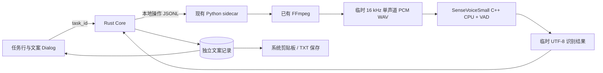

# SenseVoiceSmall 单视频文案提取集成方案

> 历史记录：2026-10-23 用户已要求更换为 Fun-ASR-Nano，Windows 可选 CUDA。本文的 SenseVoice/CUDA 接口与构建命令不再是当前契约；当前实现见 [Fun-ASR-Nano](fun-asr-nano.md)。

日期：2026-10-23。状态：**已实现，Windows CPU 与真实 Tauri 已验证；跨平台安装验收见[验证记录](sensevoice-transcription-validation.md)**。

用户已确定：采用 SenseVoiceSmall；模型按需下载；支持单个已下载视频提取文案、复制和导出 TXT。本文将这些需求落实为可实施的产品、数据及进程契约。本文保留批准方案的行为契约，数据表示和验证状态按最终实现更新。

## 1. 方案与范围

- 使用 **SenseVoiceSmall Q8 GGUF + FSMN-VAD + 官方 C++ CPU 运行时**。
- 小体积原生运行程序随应用分发；两个模型文件由用户点击后下载一次，之后离线使用。
- 复用应用现有 Python sidecar 进行依赖下载、FFmpeg 发现和本地进程编排；不添加 PyTorch、FunASR Python 包或 CUDA 依赖，用户无需另外安装 Python。
- 从“下载任务”中的已完成视频进入；四个平台共用本地处理路径，每次只运行一个文案提取操作。
- 输出模型实际识别的文本，不进行摘要、润色、翻译或纠错改写。
- 首版采用 CPU；本轮不包含 GPU 包、批量转录、自动随下载转录、任意本地文件导入、SRT、说话人分离或文本编辑器。

原视频及其下载成功状态保持不变；转录失败或取消仅影响文案提取。沿用 [AGENTS.md](../AGENTS.md)、[DESIGN.md](../DESIGN.md)、[技术方案](tauri-desktop-technical-plan.md) 和 [运行依赖](runtime-dependencies.md) 的相关边界。

## 2. 当前实现中可复用的部分

| 当前来源 | 已有能力 | 本次配套修改 |
| --- | --- | --- |
| `src/main.tsx` | 统一任务列表、已完成视频行、图标操作、图集弹窗 | 增加提取/查看文案入口，挂载独立文案 Dialog |
| `src/components/runtime-dependencies.tsx`、`src/api.ts` | 应用层依赖状态、安装进度、取消和切页保留 | 新增 `sensevoice` 模型项，复用同一安装入口和状态 |
| `src-tauri/src/desktop.rs` | 原生保存对话框、剪贴板插件 | 增加读取、启动、取消、复制和导出文案命令 |
| `src-tauri/src/desktop_core.rs` | SQLite、worker 跟踪、关闭流程、任务身份和本地路径 | 增加单个活动转录操作及关联文案记录 |
| `src-tauri/src/python_bridge.rs` | 协议 v3、取消、Windows Job / Unix 进程组 | 增加转录消息、错误白名单和独立超时规则 |
| `python-engine/runtime_dependencies.py`、`runtime_assets.py` | 按实际字节下载、固定大小/hash、暂存提交、系统代理 | 新增固定模型资产及其下载目标校验 |
| `python-engine/local_tools.py` | 系统/托管 FFmpeg 发现 | 原样复用于本地音频提取 |
| `python-engine/pyinstaller.spec`、现有三平台 CI | onedir 分发、三平台构建 | 带入固定源码构建的原生 CPU 程序及许可 |

当前任务 snapshot 存在 `download_tasks` 中；不将长篇文案塞进 snapshot、`task_updated` 或解析缓存，也不改造下载队列。

## 3. 用户流程

### 3.1 任务行入口

在已完成视频行的“播放视频”之后增加一个 `FileText` 图标按钮，使用现有 `ghost`、Tooltip 和可访问名称规则。

| 条件 | 入口及行为 |
| --- | --- |
| 已完成视频、本地文件存在、无结果 | `提取文案`，打开 Dialog；不自动开始处理 |
| 当前正在提取 | Spinner + `正在提取文案`，点击可重新打开该操作 |
| 已保存结果 | `查看文案`，直接展示已保存文本 |
| 视频已移动/删除，但有结果 | 仍可查看、复制和导出已有文案；不允许重新提取 |
| 视频已移动/删除，且无结果 | 不提供可执行的提取入口，沿用文件缺失提示 |
| 图集、未完成、失败或取消的下载 | 不提供提取入口 |

已有其他视频正在提取时，允许查看已保存文案；新的“开始提取”禁用，并提供 `查看正在提取的视频`。不建立转录等待队列，不修改下载并发设置。

### 3.2 文案 Dialog

复用现有 shadcn `Dialog`、`Button`、`Alert`、`Spinner`、`Progress`，标题为 `视频文案`，下方显示当前作品标题。文本区域只读、可选中、保留换行，并使用普通文本渲染。

建议宽度 720px，上限为视口减 32px，高度不超过 85dvh，正文独立滚动、底部操作保持可见。使用 DESIGN.md 亮色 token；正文 14px，帮助文字统一 `text-xs text-muted-foreground`，错误保持语义色。键盘支持 Tab、Escape、文本选择和系统复制快捷键；关闭后焦点回到原入口，原任务已移除时回到列表。

| 状态 | 主内容 | 操作 |
| --- | --- | --- |
| 尚未安装模型 | 模型名称、准确下载大小、下载后可离线使用 | `下载模型`、`关闭` |
| FFmpeg 缺失 | “提取视频音频需要 FFmpeg” | `下载 FFmpeg`；沿用依赖下载，不静默安装 |
| 模型或 FFmpeg 下载中 | 实际字节进度、校验/安装阶段 | `取消下载`、`关闭` |
| 依赖就绪、尚无文案 | “提取当前已下载视频的语音文案” | `开始提取`、`关闭` |
| 处理中 | `正在提取音频…` / `正在加载模型并识别…` / `正在保存文案…` | `取消提取`、`关闭` |
| 成功 | 文本、模型与提取时间 | `复制全文`、`导出 TXT`、`重新提取` |
| 未识别到语音 | 明确空结果，不显示伪成功文案 | `重新提取`、`关闭` |
| 失败、取消或重启中断 | 持续显示原因；若有上次结果则继续展示并标注 | `重新提取`，有旧结果时仍可复制/导出 |

依赖全部就绪后仍由用户点击“开始提取”；下载模型完成不自动开始转录。关闭 Dialog、切页不取消任务；用户点击“取消提取”或退出应用才终止。模型下载入口与设置页共享同一个安装操作，不能形成两套下载状态。

### 3.3 设置页

“系统设置 → 运行依赖”在现有工具卡片之后增加 **语音转录模型 · SenseVoiceSmall** 卡片，显示 CPU、版本/修订、安装位置、实际大小和已安装/未安装/需要修复状态。保留现有工具顺序与行为。

只提供当前所需的一组模型，不增加模型选择器、GPU 设置、自动更新、镜像配置或后台下载。版本不匹配时由用户点击下载当前版本，失败保留仍完整的旧模型；不自动扫描用户的其他模型缓存。

## 4. 模型资产和按需下载

2026-10-23 已通过生产下载代码完整下载下列资产，逐文件计算大小和 SHA-256，与固定 Hub 元数据一致，并完成离线加载及真实推理。以下值已作为生产 manifest。

| 资产 | 仓库与固定 revision | 字节数 | 文件 SHA-256（实际文件核对） |
| --- | --- | ---: | --- |
| `sensevoice-small-q8.gguf` | `FunAudioLLM/SenseVoiceSmall-GGUF` / `90c1c61912018b70ada0fcc024ea24aca62f2e63` | 254208320 | `4ae45c94422de949b387e2e0fb10d7e14e4c42c69db30c3444ecc7d4b844b7c5` |
| `fsmn-vad.gguf` | `FunAudioLLM/fsmn-vad-GGUF` / `6840bae4c5c92ee8c04faaf4db23dd0105098d7f` | 1720512 | `1270f2559c495f4e7b6e739541151027d360761a3fda43fc147034f5719f5479` |

两模型合计 **255928832 bytes，约 256 MB / 244 MiB**，另计许可与来源文本。模型卡的“约 235 MB”不能作为当前生产下载大小或完整性判断。界面若沿用 MiB 换算，应使用相应单位；进度按 manifest 的字节数计算。

模型目录为 `<应用数据目录>/runtime/sensevoice/`，包含两个固定文件、来源/许可及安装 manifest。原生程序位于内置引擎资源的 `asr/`，通过打包资源位置定位，不搜索任意 PATH 中的同名 ASR 程序。

安装沿用现有依赖机制，但增加以下必要适配：

1. `tool=sensevoice` 表示两个模型组成的一套依赖，共用现有安装互斥；FFmpeg 仍单独检测和安装。
2. URL 使用固定 revision 的 HTTPS resolve 地址；不以 `main`、远程脚本或远程可执行代码安装模型。
3. 现有重定向只允许 GitHub 域名，不能直接用于 Hugging Face。按实际下载重定向链，仅为模型下载允许 huggingface.co 与 us.aws.cdn.hf.co；不放宽 FFmpeg/Deno 的边界，不允许通配域名或任意跳转。
4. 使用系统网络/系统代理，不传平台 Cookie、平台代理或账号配置。
5. 下载到专属 `.install-*` 暂存，逐文件流式验证长度及 SHA-256。全部验证、离线加载冒烟通过后，整套提交；失败、取消或磁盘不足不把半成品标为可用。
6. 下载/修复使用完整 hash；普通启动检测只检查对应 manifest、存在性和大小，不在每次启动加载模型或全量 hash。实际加载失败显示修复提示。
7. 模型加载冒烟使用随应用分发的短音频测试资源，禁止验证时访问外网。它只证明当前运行程序能加载和推理，不证明真实视频识别质量。
8. 安装期间不得启动转录；转录期间禁止替换模型。查看、复制、导出旧文案不受影响。
9. 模型专用下载上限为 30 分钟、安装整体 45 分钟，读取超时沿用 15 秒；两处 Python/Rust deadline 同步，既有 FFmpeg/Deno 和平台媒体超时保持不变。真实低速下载验证后按证据调整常量，不增加用户配置。

取消/退出先回收进程及下载连接，再删除本次暂存。异常退出遗留的安装暂存纳入现有应用专属暂存清理；不扫描或清理其他用户目录。

## 5. 本地处理架构

### 5.1 身份、输入和音频

- 前端启动时只传 `task_id`；Rust 从现有已完成记录取得路径并复用 `playback_path` 的视频资格判断。不接受前端媒体 URL、任意路径、模型路径或 CLI 参数。
- 四个平台的视频一律处理本地文件，不再解析分享链接，不联系平台，不读取账号信息。
- 选取文件的第一个音频流 `0:a:0`，转换为 16 kHz、单声道、16-bit PCM WAV；原视频不改写，不增加用户可见的同目录音频文件。
- 没有音轨时明确报“视频没有可识别的音轨”；损坏或不支持的媒体格式单独报转换失败，不把二者当成凭据/网络错误。
- 每次操作使用独立应用暂存目录。操作开始和提交前检查源文件的规范路径、大小与高精度修改时间；变化则不提交本次结果。不新增对完整视频重复计算 SHA-256 的前置步骤。

### 5.2 推理和输出

- Python 通过参数数组启动随应用打包的 `llama-funasr-sensevoice`，读取本地 Q8 与 VAD 文件；使用 CPU 或已安装且兼容的 CUDA 后端和上游 VAD 分段，单段上限初设 30 秒。
- 自动识别受支持语种。不调用模型服务器、不监听端口，不以 vLLM/Docker 作为桌面依赖。
- CLI stdout 仅作为识别数据，不能继承 sidecar stdout；识别内容写专属临时文件，stderr 单独捕获并限制保留量，排空/落盘不能阻塞子进程。
- 不解析人类可读 stderr 来推算百分比。Python 发送阶段事件和约 5 秒一次心跳；本节原首版识别阶段使用不确定进度。2026-10-25 已由 [Nano 真实分段进度](fun-asr-nano.md) 覆盖：使用专用完成通知或逐段结果计算识别比例，模型加载仍只有加载状态，不伪报百分比。
- CLI 默认隐藏语言/情感等标签。已核对固定 GGUF 的 `sv.query_tokens=[0,1,2,14]`，启用 withitn；短语音实际输出“开放时间早上9点。”。不传 Python API 的 use_itn 参数。
- 只做必要的 BOM/首尾空白/换行规范化，不删除重复口语、不重新分句改写、不调用其他模型。首版文本可以是连续文案；不承诺按句/逐字时间戳。
- 无有效识别文本以 `no_speech` 返回，展示“未识别到可用语音”；不创建空 TXT、不把空白文案当成功。无结果也不自动改用另一个模型。
- 只有 FFmpeg 和识别进程正常退出、结果 UTF-8 与固定结果文件校验通过、源文件未变化、SQLite 提交成功后才报告完成。

### 5.3 JSONL、超时与资源

协议保持 v3，新增可选方法 `transcribe_video`，升级内置 engine 版本并与 Rust 握手要求同步；不重用已有下载成功消息。新增 `transcription_progress` 与最终 `transcribed`，错误走现有受控 error 消息。

最终消息只返回固定结果文件名、字节数、识别是否为空和必要时长，不把全文放进单行 JSONL。Rust 按现有文件边界方式校验固定文件和大小后读取，避免突破现有 1 MiB 单行上限。初始结果文本上限为 16 MiB，超限明确失败，不静默截断。

当前 Rust bridge 使用普通操作约 80 秒总超时、65 秒消息等待，不能原样套用转录。处理方式：

- 转换阶段独立限时 30 分钟；转换后的 WAV 提供实际音频时长，无需新增强制 FFprobe 依赖。
- 识别阶段限时 `max(600 秒, 3 × 实际音频秒数 + 120 秒)`；Python 对 native 调用执行 deadline，Rust 根据受校验的阶段/时长消息设置对应等待上限。排除普通操作 80 秒总上限，但保留心跳缺失超时。
- 不新增其他方法的超时放宽，不把心跳本身当成推理进度或取消成功。
- Windows 继承现有 Job、macOS 继承现有进程组；不允许 FFmpeg/native 脱离父进程树。取消和应用关闭后必须确认进程树回收，再释放暂存和转录名额。
- 临时音频/识别文件在成功、失败、取消后清理；异常退出留下的暂存通过应用持有的暂存记录在启动恢复中清理，不按未知目录通配删除。

单视频不意味着短视频。当前上游 CLI 会将音频读入内存，VAD 限制的是推理分段长度，不能据此宣称总内存恒定。第一阶段必须测试长视频的波形内存和峰值推理内存；不在未测时承诺支持任意时长。

## 6. 转录状态、结果保存和恢复

### 6.1 状态归属

下载 `Task.status` 始终保持原有语义。文案单独记录：无记录表示未开始；操作状态为 `running / completed / no_speech / failed / canceled / interrupted`。进行中的 `extracting_audio / recognizing / saving` 为阶段信息。

Rust 是唯一状态权威，每个应用实例最多一个活动转录；不占下载槽位，仍允许正常下载。并发可能影响 CPU/磁盘性能，使用实测数据评估，不提前引入动态调度或后台服务。

运行状态由后端保存和查询，React 仅展示。事件带 `task_id`、`operation_id` 及单调递增序号；前端忽略旧操作、迟到事件，关闭弹窗不丢失后端状态。订阅与初次快照读取需避免漏事件。

### 6.2 最小数据模型

新增独立 `video_transcripts` 表，一条下载任务最多保存一份最近成功结果及最近尝试状态：

| 字段 | 含义 |
| --- | --- |
| `task_id`（主键） | 关联已有下载记录 |
| `snapshot`（TEXT JSON） | 最近一次尝试的 state、error_code、updated_at、operation_id、sequence、phase 及可空 result；沿用现有任务快照存储方式 |

`result` 保存正文、source `{path, size, mtime_ns}`、model revision、pipeline revision 和完成时间；不进入下载快照或状态事件。终态 SQLite 写入失败时报告 failed，并在本次 Core 内存中保留可查询的失败状态和先前已落库结果；不把未落库的新正文当作成功。下次启动对旧 running 记录执行 interrupted 恢复。

`pipeline revision` 绑定 native 源码、VAD 修订及音频/规范化策略；不新增跨任务、跨平台转录去重缓存。operation ID、序号随快照保存，取消句柄由 Core 活动操作持有，重启不恢复执行。

- 点击“查看文案”不重新运行。普通“开始提取”若已有同源有效结果则返回结果；只有“重新提取”明确要求重新执行。
- 重新提取时保留上次成功结果；新结果全部成功后才替换，失败/取消不丢旧文案。新一次 `no_speech` 也不悄悄抹除旧结果，应标注本次未识别到语音。
- 本地文件变化时标注“这是上次提取的文案，本地视频已变化”，允许复制/导出旧结果，重新提取才建立新关联。
- 视频缺失后仍可读取已有文案。软件升级或模型升级不自动删除已保存文案，不自动重新处理。
- 启动将遗留 `running` 改为 `interrupted`；已完成文案保留，用户手动重试。转录不得沿用下载的“重新解析平台链接”恢复方式。

### 6.3 删除记录和原文件

- 从列表移除：同时删除关联文案数据库记录，保留视频及已导出的 TXT。
- 删除本地视频：沿用现有契约，删除视频及任务/文案数据库记录；已导出的 TXT 不在任务文件清单内，不扫描和删除它。
- 操作仍在转录时，单条移除/删除先自动取消并等待资源回收，再执行原操作；不增加二次确认。后端需同步升级相应删除命令的异步等待，避免只禁用前端按钮。
- 批量清理历史沿用“跳过仍被 worker 占用记录”的已有规则，将正在转录的记录也视为占用；其余记录及关联文案同事务删除，结果报告实际条数。
- 数据库提交前再次确认对应任务仍存在且操作仍是当前操作，防止迟到结果恢复已删除记录。清理文案与删除任务使用同一事务，不依赖尚未启用的外键级联假设。

## 7. 复制和 TXT 导出

**复制全文**：原生剪贴板插件写入后端已保存的纯文本；前端只传 `task_id`。成功反馈“文案已复制”，失败保留内容并显示错误；不把语言标签、作品元数据或日志混入文本。

**导出 TXT**：复用原生保存对话框，默认目录为该视频所在目录；文件已缺失或原目录不可用时使用现有下载目录。默认文件名为 `<实际视频文件名去扩展名>.txt`，仅建议保存位置，不自动落盘。

- 内容与复制使用同一份已保存正文，采用 UTF-8（带 BOM，便于 Windows 文本工具识别）及平台常规换行；不添加标题、链接、模型名或时间戳。完成后显示实际导出位置。
- 取消保存对话框是正常取消，不记为导出失败。
- 正常既有 TXT 是否覆盖由原生保存对话框处理，不再叠加应用确认框。必须拒绝导出目标与源视频为同一实际文件（包含链接/别名情形），避免用户手动更名造成视频被覆盖。
- 写入同目录临时文件后再提交；失败不留下半个 TXT，也不删除原有文件。完成状态以提交成功为准，不以打开对话框为准。
- 导出失败只影响该次导出，不清除数据库文案，不改变下载/转录结果。

## 8. 接口和代码改动范围

| Tauri 命令 | 输入 | 返回 |
| --- | --- | --- |
| `list_video_transcripts` | 无 | 无全文的状态摘要列表，用于任务行 |
| `get_video_transcript` | `task_id` | 当前快照及可选成功正文 |
| `start_video_transcription` | `task_id, force=false` | 当前操作/已存在结果快照，不等待整段推理 |
| `cancel_video_transcription` | `task_id, operation_id` | 资源回收后的当前快照 |
| `copy_video_transcript` | `task_id` | 剪贴板写入成功/错误 |
| `export_video_transcript` | `task_id` | 实际保存路径或用户取消 |

事件 `transcription_updated` 只包含状态摘要及操作身份，不广播完整文案。运行依赖仍使用现有 check/install/cancel 命令，将 tool 类型扩展为 `sensevoice`；不另建模型下载 API。

新增 `src/components/video-transcript.tsx`、`src-tauri/src/transcription.rs`、`python-engine/transcription.py`，分别承载 UI、领域数据/校验及本地转录编排；不拆出独立 ASR 插件体系或通用 backend interface。

配套更新限于上述现有入口、原生程序构建/打包、测试、来源声明和相关文档。DESIGN.md、技术方案与运行依赖文档已同步本次操作/弹窗和实现契约。

错误区分模型缺失/损坏、FFmpeg 缺失、无音轨、媒体转换失败、识别进程失败、源文件变化、资源不足、超时、取消和数据库/导出写入失败。按现有错误白名单扩展，不直接显示 subprocess 原始日志，也不把无语音作为异常崩溃。

## 9. 原生运行时与三平台分发

固定上游为 `modelscope/FunASR` 的 `runtime/llama.cpp`，源码 commit：`fbbfe01800a8c4c9103cb2150fb1a5d06cc64758`；其中 CMake 固定的 llama.cpp commit 为 `803b7fcae893e9caaee3921779628fef83ac0965`。二者已在 Windows 真实加载及推理中确认兼容，不跟踪浮动分支。

- Windows x64、macOS Intel、macOS Apple Silicon 在现有构建矩阵中分别构建同一源码的 `llama-funasr-sensevoice` CPU 目标；不只依赖当前缺少 macOS Intel 的预编译 Release 资产。
- 指令集使用各架构的可分发基线，不把 CI 宿主机的 AVX/AVX2 自动探测带到通用安装包；CPU 基线与最低系统版本需落到构建参数和来源清单。
- 原生程序及其必需库/许可证作为 PyInstaller 数据资源分发，按实际 `sys._MEIPASS` / 开发目录规则定位；不假定数据一定在 onedir 的可执行文件同层。
- macOS 沿用本地 ad-hoc 签名；核查 native、打包内嵌程序的签名及执行权限，不额外要求 Developer ID/公证。
- 保留 FunASR runtime、llama.cpp、实际带入的第三方代码以及两个模型的真实许可。模型卡许可证标签与实际来源记录同时核对，不以工具包许可证代替模型许可。
- 发布前应证明：用户无系统 Python/PyTorch/CUDA 时仍能安装、按需下载并离线识别。构建成功不替代上述运行验证。

## 10. 实施顺序与验收

### P0：验证候选运行时与权重

先在隔离目录验证固定 Q8/VAD 文件的真实下载大小、hash、重定向链、加载、withitn、无语音和长音频内存；核对原生源码及依赖许可。构建三平台 CPU 程序并执行短音频推理；不可只用 `--help` 或文件存在性证明可用。

若候选组合无法提供可用文本或目标平台无法运行，应先修正具体组合并记录原因，不直接引入 Python/PyTorch 或另一个模型作为隐藏替代方案。

### P1：模型下载、bridge 与 Core

实现下载/修复、模型状态、转录协议、取消/超时、worker 回收、独立结果表和重启恢复。验证下载任务和平台设置不受影响。

### P2：用户闭环

接入任务行、文案 Dialog、设置卡片、复制、原生 TXT 导出以及删除记录联动。同步现行文档；界面分别验证浏览器预览和真实 Tauri。

| 验收层 | 必须覆盖 |
| --- | --- |
| 依赖下载 | 首次缺失、实际下载进度、完整 hash、错误长度/hash、重定向拒绝、离线、磁盘不足、取消、旧完整模型保留 |
| 推理/协议 | 含空格和中文路径、正常文本、无音轨、静音/音乐、损坏媒体、native 非零退出、超长 JSONL 防护、心跳和阶段超时 |
| 生命周期 | 单转录互斥、同时下载、取消后立刻重试、关闭 Dialog/切页、应用退出、异常重启、迟到事件和源文件变化 |
| 数据/文件 | 成功结果重启保留、失败重提保留旧结果、移除/删除关联清理、批量清理跳过忙碌记录、源视频字节未改写 |
| 复制/导出 | 中文/英文/换行一致、原生剪贴板真实粘贴、Windows TXT 编码、取消保存、已存在 TXT、禁止覆盖源视频、写入失败无半成品 |
| UI | 未安装/下载中/处理中/成功/失败/空语音/文件缺失；1440×900、1280×800、1024×680；键盘/焦点/减少动态效果 |
| 真实效果 | 普通话、粤语、英语、中英混说、带 BGM 口播；短视频和至少一段长视频，记录冷启动、总耗时、峰值内存和人工核听错误 |
| 分发 | Windows x64、macOS Intel、macOS Apple Silicon 分开记录；无系统 Python 环境、已下载模型后断网运行 |

实施 P0/P1/P2 的代码已完成。Windows 固定模型真实下载、短语音、10 分钟合成视频、中文路径、打包引擎与真实 Tauri 提取/复制/重开均 PASS；自动回归及剩余质量/平台验收逐项见[验证记录](sensevoice-transcription-validation.md)。macOS Intel/Apple Silicon 和全新无 Python 安装验收为 NOT_RUN，不能用 Windows 结果替代。

## 11. 官方来源

- [SenseVoice 模型与能力](https://github.com/QwenAudio/SenseVoice)
- [SenseVoiceSmall GGUF 模型卡](https://huggingface.co/FunAudioLLM/SenseVoiceSmall-GGUF)
- [Q8 文件元数据](https://huggingface.co/api/models/FunAudioLLM/SenseVoiceSmall-GGUF?blobs=true)（固定 revision 见第 4 节）
- [FSMN-VAD GGUF 文件元数据](https://huggingface.co/api/models/FunAudioLLM/fsmn-vad-GGUF?blobs=true)
- [FunASR C++ 运行时](https://github.com/modelscope/FunASR/tree/fbbfe01800a8c4c9103cb2150fb1a5d06cc64758/runtime/llama.cpp)
- [SenseVoice C++ CLI](https://github.com/modelscope/FunASR/blob/fbbfe01800a8c4c9103cb2150fb1a5d06cc64758/runtime/llama.cpp/sensevoice/funasr-sensevoice/funasr-sensevoice.cpp)
- [GGUF 导出与 query token 配置](https://github.com/modelscope/FunASR/blob/fbbfe01800a8c4c9103cb2150fb1a5d06cc64758/runtime/llama.cpp/sensevoice/export_sensevoice_gguf.py)

上游不同 README/模型卡可能存在近似大小或旧功能描述。实现以固定源码、固定权重及真实推理结果为准；上游 benchmark 不替代本应用的识别速度和效果验收。

## 12. Windows CUDA 扩展（2026-10-23 用户批准）

原生 CPU 程序继续随软件分发，macOS 保留 CPU。Windows 在同一项语音模型依赖中选择 CPU 或 CUDA 版；对外仅 `tool=sensevoice, variant=cpu|cuda`。普通检测和 CPU 操作不查询显卡；CUDA 下载时检测适配性，首次安装补齐模型和组件，切换时复用完整模型。验证并成功提交后保存所选版本，失败恢复原安装。当前引擎 0.10.0、协议 v3。具体契约以 [CUDA 集成说明](cuda-acceleration.md) 为准。
