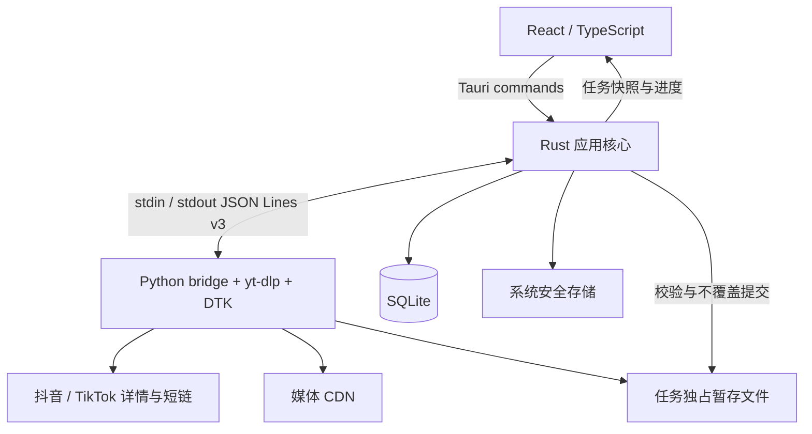

# 抖音 / TikTok / YouTube 轻量桌面下载器技术方案

日期：2026-10-14。当前决策：**yt-dlp + DTK 双解析引擎，共用 yt-dlp 网络及下载器，接入视频与图集 GUI 下载；不恢复旧 wreq/服务端或 Rust 媒体 HTTP 下载链路。**

状态：双引擎与图集按用户新决定正式实现，当前验收见 [双引擎验收](dual-engine-validation.md)，细节见 [接入方案](dtk-dual-engine-plan.md)。以下 M1/M2 阶段描述保留历史：M1 曾统一为 yt-dlp，旧服务引擎与生产依赖已退役；离线测试与双平台源码/打包下载通过；抖音详情请求使用用户批准的最小签名补丁，用户已批准进入 M2；全新无 Python Windows 环境验收移至 M3，仍待验证。详见[当前 M1 验证](m1-validation.md)；[独立试验](ytdlp-validation.md)与[旧 M1 历史](m1-legacy-validation.md)分别保留。

## 1. 产品范围与决策

目标技术栈：**Tauri 2 + React + TypeScript + Rust 应用核心 + Python/yt-dlp + DTK sidecar + SQLite**。界面名称“映取”，视觉与交互以 `DESIGN.md` 为准。

默认视频由 yt-dlp 解析、图集由 DTK 底层切片解析，表单允许明确选择引擎；自动选择按作品类型决定，失败不切换引擎。yt-dlp 承担共用详情/媒体请求及 HTTP 下载；Rust 只管理任务与文件最终提交，不接收签名媒体 URL 发起另一条 HTTP 链路。DTK 不包含上游 UI、服务端、身份池或浏览器服务。

| 能力 | 首版行为 |
| --- | --- |
| 输入 | 每次单个作品，支持长链、短链或包含一条链接的分享文案；多链接拒绝 |
| 预览 | 标题、作者、封面、时长；可选字段缺失不阻止下载 |
| 平台设置 | 抖音、TikTok、YouTube 各自独立 Cookie、User-Agent、可选 HTTP/SOCKS5 代理 |
| 下载 | 实际下载字节、速度；总大小未知时显示不确定进度 |
| 并发 | 同时下载默认 2，可配置 1–3；超出容量进入 FIFO 等待队列 |
| 任务操作 | 取消、手动重试、打开文件夹、移除记录 |
| 删除文件 | 明确的本地文件删除操作，必须二次确认；移除记录不删除文件 |
| 持久化 | 重启恢复任务记录与已完成列表，不恢复网络下载 |
| 分发 | Windows 11 x64 优先，随后 macOS Intel / Apple Silicon；用户无需安装 Python |

不做作者批量采集、评论、平台内容搜索、直播、身份池、自动游客身份、内置登录浏览器、云同步、开放 API 或 MCP。不提供暂停、断点续传、退出后后台下载、自动重试或转码。历史列表搜索不等于平台内容搜索。

图集每张优先平台明确提供的原图，缺原图或原图 HTTP 404/410 时使用高清；其他网络、身份、风控错误不降级。保留原响应格式，不转码，实际来源逐张展示。抖音/TikTok 仍选择单文件直接 HTTP(S) 格式。YouTube 由 yt-dlp 解析单视频，支持兼容容器的分离音视频 HTTP(S) 规格，使用本机 FFmpeg stream copy 合并，不转码。仅分段流且无直接下载规格时返回 `UNSUPPORTED_CONTENT`。YouTube 使用本机 Node.js 22+ / Deno 2.3+ 及锁定的 yt-dlp-ejs；FFmpeg 与 JS runtime 不随安装包分发；用户可在系统设置的运行依赖中按需下载到应用专属目录。手动 Cookie 优先；未填写时通过 yt-dlp 读取系统 HTTPS 默认浏览器并按平台过滤，不回写 SQLite。读取失败可匿名尝试公开作品并提示限制；不尝试其他浏览器。工具检测和验收见 [YouTube 说明](youtube-validation.md)。

## 2. 当前证据与依赖取舍

### 2.1 已验证与未验证

- 固定基线：`yt-dlp==2026.8.19`，运行时版本为 `2026.08.19`；Python 开发基线 3.12。
- TikTok 作品 `7676209499589446945`：现有 Cookie、Edge 150 UA，SOCKS5 与 HTTP 代理均下载成功；687,985 bytes，1024×576，约 18.85 秒，音视频完整解码通过。
- 以上为迁移前独立试验，脚本现已退役；当前 sidecar 与 Rust 探针结果见 M1 验证记录，双平台和安装包未全部通过。
- 新引擎抖音下载、双平台长短链组合、正式进程取消、重启恢复、打包与 macOS 均须重新验证。旧引擎抖音成功不可替代新引擎验收。

### 2.2 目标依赖

| 项目 | 决策 |
| --- | --- |
| `yt-dlp==2026.8.19` | 视频解析及共用网络、媒体下载器；显式锁定版本 |
| DTK 5.1.3 白名单切片 | 第二解析引擎；图集及可选视频解析，仅复用平台参数、NativeSigner 与 parser |
| pydantic / structlog / httpx | DTK 最小导入闭包必要依赖；精确版本和许可证随锁文件及 sidecar 分发 |
| Python 标准库 | JSONL、CookieJar、输入校验及轻量协议映射 |
| PyInstaller | 开发/构建依赖，打包项目自己的 Python bridge 与 yt-dlp |
| pytest 等现有测试工具 | 按实际保留的测试使用，不混入运行依赖 |
| Rust `tokio`、`serde`、`serde_json`、`anyhow` | 延续现有进程、异步 I/O、消息与错误处理用途 |
| Tauri、SQLite 与系统凭据访问 | 按桌面阶段的实际工程引入，不把拟定选型写成已安装 |

该 yt-dlp 基线的包元数据没有必选第三方 Python 依赖；`default`、`curl-cffi` 等为可选 extras。首轮沿用已成功的最小包，不默认安装全部 extras。某平台确需额外网络依赖时，必须由复现证据决定并同步锁定、许可证和打包验收。[官方依赖声明](https://github.com/yt-dlp/yt-dlp/blob/2026.08.19/pyproject.toml)

以下依赖与资产已从 M1 实现退役，相关引用与失效测试同步删除：

| 旧资产 | 迁移处理 |
| --- | --- |
| `vendor/dtk/`、旧 manifest、初始化补丁 | 删除，取消固定旧上游提交和 vendoring 工作流 |
| `pydantic`、`structlog`、`wreq`、`httpx` 及其仅由旧引擎引入的传递依赖 | 从 Python 输入清单移除并重新生成运行/开发锁文件 |
| 旧 `engine.py` 的签名、parser、指纹模拟与 transport 编排 | 替换为 yt-dlp 适配；不保留兼容 wrapper |
| Rust `reqwest` 及旧下载专属依赖/feature | 删除旧媒体 HTTP 调用后移除；保留仍被文件或测试使用的依赖 |
| `src-tauri/src/downloader.rs` 的 HTTP 流式下载实现 | 移除；任务调度、文件校验与最终提交归 Rust 核心 |
| `src-tauri/media-domains.json` 的 dtk 生成来源 | 取消旧生成链；必要的双平台目标约束依据 yt-dlp 实际请求与验收重新确认 |
| 旧 X-Bogus/A-Bogus golden、dtk parser replay 与专属 fixtures | 删除已失效测试；用 yt-dlp 适配契约与离线下载 fixture 替代 |
| `vendor/UPSTREAM.md` 中旧引擎说明 | 实际删除旧 vendor 时退役，改为记录 yt-dlp 版本、许可证与打包依赖 |

迁移只更新项目虚拟环境，不卸载用户全局环境或删除已有下载文件。`DESIGN.md`、`docs/ui` 与真实历史验收记录不因引擎迁移而改写。

## 3. 架构与职责



| 层 | 职责 | 边界 |
| --- | --- | --- |
| React | 输入、预览、设置、任务与历史 | 不访问详情接口、不启动进程、不提交媒体 URL 或任意文件路径 |
| Rust | 任务唯一状态源、队列、配置快照、进程生命周期、取消、进度归并、文件最终提交、数据库与凭据 | 不计算签名、不下载媒体、不另建平台提取器 |
| Python bridge | 单链接识别、配置选择、调用选定解析引擎、结果及错误映射、脱敏事件 | 不维护业务队列、不写 SQLite；仅按当前授权经 yt-dlp 读取默认浏览器 Cookie，不读取代理凭据 |
| yt-dlp | 短链展开、平台提取、详情与媒体网络请求、流式保存暂存视频或图集 | yt-dlp 仅启用两平台单视频提取器，DTK 仅单作品解析，不开放任意 CLI 参数或插件 |
| SQLite | 任务、路径、元数据、设置与 Cookie | 用户批准 Cookie 直接保存；不保存代理密码或带 token 的详情/媒体 URL |

解析与下载均使用同一任务创建时的两平台配置快照；bridge 统一识别平台并只使用对应配置。设置修改只影响新任务。凭据经 stdin 进入专属子进程内存，平台 Cookie 限定到对应 HTTPS CookieJar 域，不能作为全局 Cookie header 发送给所有 CDN。

## 4. yt-dlp 适配方式

采用 Python `YoutubeDL` 嵌入方式，由项目自己的 bridge 暴露固定协议；不解析面向人的 CLI 日志，不把裸 yt-dlp 命令行开放给前端。使用内存 CookieJar、自定义 logger 与 `progress_hooks`。[官方嵌入说明](https://github.com/yt-dlp/yt-dlp#embedding-yt-dlp)

- 预览阶段调用 `extract_info(..., download=False)`，只返回白名单展示字段、作品身份与规范链接；不返回原始 info dict、媒体 URL 或 headers。
- 用户点击下载、取得槽位后，通过规范作品链接重新提取并下载。下载前校验平台与作品 ID 和预览一致；不复用预览时的过期媒体地址，也不增加本地媒体 URL TTL 缓存。
- 仅选择符合第 1 节限制的格式，不使用会触发分轨合并的默认格式选择。提取器、格式选择与禁止后处理要在真实 yt-dlp 层验证，不能只断言配置字典。
- 禁用下载续传、自动网络重试、playlist、额外字幕落盘、info JSON、yt-dlp 自身磁盘缓存、插件及用户全局配置加载；保存一个视频文件及最高可用分辨率封面。Cookie 不导出临时 Netscape 文件。
- `progress_hooks` 只映射下载字节、已知总字节与速度。估计总大小不作为准确百分比的分母，缺失字段为 null。hook 的 `finished` 不等于业务完成。
- 官方 logger 的自由文本默认不直接输出；错误映射稳定错误码，无法可靠区分原因时保留通用失败，不猜测 Cookie 失效或风控。
- 不承诺 User-Agent 等于 TLS 浏览器指纹。废弃旧 wreq 的 `windows-chrome` 指纹预设和匹配规则；首版保存 UA，未验证的 impersonation 能力不进入配置契约。现有设计素材若出现指纹相关内容，实施时记录此技术边界，不改写素材掩盖差异。

## 5. 协议与进程生命周期

当前为 **协议 v3**，引擎 0.5.0。Rust 与 sidecar 同步升级，不兼容旧 v1/v2，不增加旧协议 fallback。DTK 版本及 commit 以 vendor manifest 为准。

### 5.1 进程模型

每次解析或下载操作使用一个独占 sidecar 进程，一次操作结束即退出。预览解析最多同时执行一个；下载进程数量由 Rust 下载槽位限制为 1–3（默认 2）。这是取消与并发隔离边界，不维护常驻多请求引擎或额外进程池。

Rust 保存句柄并持续读取 stdout/stderr。UTF-8 JSONL，一行一条消息并及时 flush；stdout 仅协议，stderr 仅脱敏诊断。当前 M1 启动上限 15 秒、单次解析含启动总上限 80 秒；读取协议无进展上限 65 秒，终端后退出上限 5 秒。下载不以固定短总时限截断长视频，yt-dlp 使用 socket timeout；超时会终止并回收操作进程。

取消、解析超时、协议损坏或应用退出：Rust 终止对应进程，等待退出后再清理任务暂存文件；不能仅标记 UI。Windows 验证父进程异常退出时子进程回收，macOS 分别验证对应机制。stdin EOF 需能结束正在处理操作的 sidecar，而非仅在同步 yt-dlp 调用返回后才检测；实现时用进程回收机制与 EOF 监测验证，不因选用同步 API 放弃取消契约。关闭网络任务后才释放槽位。

### 5.2 消息契约

| 消息 | 字段与约定 |
| --- | --- |
| `ready` | `protocol_version=3`、`engine_version`、`yt_dlp_version`、`dtk_version`、`dtk_commit`；Rust 校验与分发版本一致 |
| `identify_input` 请求/`identified` | 识别平台、作品 ID、规范链接、类型和实际 resolver；长链接纯本地识别，短链只经 GuardedRH 展开，不请求详情或媒体 |
| `resolve_video` 请求 | `id`、单条 `input`、`resolver`（auto/yt-dlp/dtk）、可选 Rust 专属 `preview_dir`、两平台配置快照；凭据只经 stdin |
| `download_video` 请求 | `id`、规范作品链接、预期 platform/video_id/kind/image_count、实际 resolver、原任务配置快照、Rust 创建的专属 staging 目录 |
| `resolved` | 同一 `id`、platform、video_id、canonical_url、title、author、cover_url、duration_ms、width、height、filesize、filesize_approx、kind/resolver、images（尺寸/来源/本地相对预览名）、music（title/author）；可选字段可空 |
| `progress` | 同一 `id`、downloaded_bytes、total_bytes、speed_bps、completed_items/total_items；不包含上游原始 dict |
| `download_finished` | 同一 `id`、平台/作品身份、staging 内相对文件名、实际字节数与容器；图集为 files 清单（每文件 bytes/hash/尺寸/来源），不含媒体 URL；仅表示引擎文件写入结束 |
| `error` | 同一 `id`、稳定 code、脱敏 message、stage；可可靠获得时附 HTTP 状态 |

请求和响应均包含 `protocol_version`。每个操作最多一个终端结果：身份识别以 `identified` 结束、解析以 `resolved` 结束、下载以 `download_finished` 结束，或以 `error` 结束。成功还必须伴随正常进程退出；EOF、超限、错 ID、错版本、重复终端消息、非零退出或缺失结果都明确失败。单条消息上限 1 MiB。

`download_finished` 之后 Rust 校验路径确实位于所分配暂存目录，视频拒绝目录，图集核对专属 album 目录与全文件清单；两者均拒绝符号链接/重解析跳转及非预期文件，再执行第 7 节文件提交。这个消息不直接映射为 UI 的 completed。

错误码：`INVALID_INPUT`、`UNSUPPORTED_PLATFORM`、`UNSUPPORTED_CONTENT`、`CONFIG_INVALID`、`ACCESS_DENIED`、`NOT_FOUND`、`RISK_CONTROL`、`NETWORK_ERROR`、`UPSTREAM_CHANGED`、`ENGINE_UNAVAILABLE`、`ENGINE_PROTOCOL_ERROR`、`TIMEOUT`、`IO_ERROR`、`INTERRUPTED`。只有可验证证据才细分登录、删除或风控；403 不自动解释为过期或 Cookie 无效。

## 6. UI 命令与状态同步

流程：设置 → 粘贴单链接 → 解析预览 → 点击下载 → 排队/下载 → 文件与记录提交 → 已完成。使用首页、下载任务、设置和关于软件四个视图；下载任务统一展示已提交的任务与已完成记录，并支持按标题或作者搜索。

| Tauri 命令 | 行为 |
| --- | --- |
| `resolve_video` | 输入分享文本及 resolver，创建 task_id，异步解析并发出快照 |
| `open_project_page` | 接收 source / issues / releases / license / credits，以及 credit-ytdlp / credit-dtk / credit-tauri / credit-react / credit-shadcn / credit-lucide 固定标识，后六项打开对应组件 GitHub 仓库；仅 releases 可附 release_tag（经正式 SemVer 标签校验），打开本项目对应 Release 详情页；失败返回 OPEN_LINK_FAILED，不接受任意 URL |
| `check_for_updates` | 无前端参数；Rust 以实际应用版本请求本项目 GitHub 最新正式 Release，返回 current_version、latest_version、release_tag、has_update、release_notes、published_at；15 秒总超时，网络、限流、无正式版及异常响应均明确失败，不伪报已是最新 |
| `get_task_image` | 接收 task_id/index，从 Rust 所拥有预览或已完成清单读取图片字节 |
| `start_download` | 仅接收 task_id，使用 Rust 保存的作品身份和任务配置排队 |
| `cancel_task` | 取消等待或终止对应子进程，资源释放后进入终态 |
| `retry_task` | 失败/取消任务复用原 ID 与创建时间，清空进度和错误后重新解析与从零下载；无作品身份时要求重输 |
| `list_tasks` | 状态筛选、分页，返回权威快照 |
| `get_settings` / `save_settings` | 非敏感设置和凭据配置状态；替换/清除 Cookie 必须明确操作 |
| `select_download_directory` | 系统目录选择与可用性校验 |
| `reveal_download` | 从记录定位文件，缺失则提示 |
| `play_download` | 只接收任务 ID，从 Rust 已完成视频记录获取本地普通文件路径，调用系统默认播放器 |
| `remove_history` | 仅移除终态记录 |
| `clear_download_history` | 无输入；Rust 选取已提交下载且不再被进程/下载清理占用的 completed / failed / canceled 记录，在单个 SQLite 事务中批量移除，返回实际移除的任务 ID 列表；不删除文件 |
| `delete_local_file` | 对应记录的明确二次确认后删除本地作品；图集仅删除任务清单文件，保留用户额外文件；保留记录并标记文件已删除，失败保留现状 |

事件 `task_updated` 返回完整展示快照：task_id、递增 revision、状态、预览、字节/速度、脱敏错误及完成路径。约 250 ms 合并进度，终态立即通知。前端先监听再读快照，按 revision 合并；重挂载重新查询。未完成最高显示 99%，文件与数据库提交后才显示 100%。

Cookie 在设置页通过 get_profile_cookie 专用命令回显多行输入，支持显示/隐藏。空输入保存即清空；未完成读取时禁止保存。公开作品解析成功只证明该请求成功，不证明登录态有效。预览清晰度显示所选下载格式的 width × height；大小优先使用实际完成字节、下载响应总大小、所选格式的 filesize，再使用标“约”的 filesize_approx，缺失时显示未知。预览估算不写入下载进度。未知清晰度、大小与速度明确显示未知；失败原因持续可见。

## 7. 状态、文件与持久化

### 7.1 任务状态

`parsing → ready → queued → downloading → completed`。解析/下载可转 failed，解析、预览、排队和下载均可取消。失败/取消且保留作品身份的任务可由用户手动重试回到 parsing；终态不被迟到事件覆盖。

Rust 是唯一状态所有者。降低并发限制不打断已开始的下载，仅约束后续调度。队列获得槽位后由保存的 resolver 重新提取作品。取消与完成串行裁决：完成已提交则保持 completed；取消先接受则不得再发布成功。重试在同一记录上递增 revision，保留 ID、创建时间、实际 resolver 与所选规格，使用重试时的最新设置快照；重新解析成功后加入 FIFO 队尾。仍占用旧操作资源的任务拒绝重试，避免旧 worker 清理新尝试。

### 7.2 文件提交

1. Rust 在选定下载目录下排他创建任务独占暂存目录，确保与最终文件同卷。yt-dlp 只能写入该目录，使用固定安全模板和自身 `.part`；不以标题作为未经处理的路径。
2. yt-dlp 流式下载，关闭续传与覆盖；下载结束完成其暂存目录内的重命名并关闭文件。失败或取消后由 Rust 在进程退出后清理本任务明确拥有的残留文件，不递归清理用户下载目录。
3. Rust 收到成功结果并确认进程正常退出后，核对作品身份、路径、非空文件、允许的容器与基本文件特征、实际大小；已知总大小必须匹配。HTML/JSON 错误页、截断或校验失败不能进入 completed。传输状态与 Content-Length 校验由 yt-dlp 负责并通过错误回传，Rust 不重发媒体请求。
4. Rust 在重命名前持久记录目标路径、暂存路径和最终字节数，以**不覆盖**语义移动到最终文件名 `<platform>_<video_id>_<本次下载UUID>.<容器扩展名>`；每次尝试独立命名，冲突明确失败，不能先检查后用会覆盖的 rename。
5. 最终文件提交成功、SQLite completed 事务提交后才对外报告完成。数据库失败时保持可恢复的中断状态，不声称下载完成。

FFmpeg 全量解码是验收手段，不作为产品运行依赖。首版重试始终重新提取并写新暂存文件，不拼接遗留 `.part`，不接受前端自定义输出模板。

### 7.3 数据与恢复

| 表 | 字段 |
| --- | --- |
| `download_tasks` | id、platform（解析前可空）、source_url、video_id、title、author、status、revision、downloaded_bytes、total_bytes、staging_path、target_path、final_size_bytes、error_code、脱敏 error_message、created_at、updated_at、completed_at |
| `platform_settings` | platform、user_agent、非敏感代理设置、credential_ref、updated_at |
| `app_settings` | 下载目录、max_concurrent_downloads（默认 2，允许 1–3） |

SQLite 位于应用数据目录，由 Rust 独占写入；Python 不访问。进度在内存维护并节流保存，状态转换持久化。source_url 为可重新提取的作品链接，任务表不保存完整分享文案、原始 info dict、Cookie、代理密码或签名媒体 URL。Cookie 单独保存在平台设置表。

Cookie 按 2026-10-13 用户决定直接存 SQLite 的平台设置表，普通设置接口仅返回配置状态；设置编辑器通过专用命令读取已保存值。代理密码经系统安全存储保护，数据库只存引用；安全存储失败明确报错，不降级明文。关闭主窗口隐藏到托盘并继续当前任务；托盘“退出映取”和系统退出请求停止所有网络任务并等待引擎回收；重启保留有完整缓存的 ready 预览；遗留 parsing/queued/downloading 标为 failed/INTERRUPTED，不自动恢复下载。解析缓存仅保存元数据与预览字节，下载仍重新提取，具体见 [缓存契约](parse-cache-validation.md)。

文件移动与数据库事务不原子：对已记录提交意图的任务，启动时核对最终文件存在且大小匹配、暂存文件已消失，证据完整才补记 completed。无法证明时保留中断，不误删最终视频。已完成文件被外部删除时保留历史记录并提示缺失。

## 8. 网络和凭据边界

- 自有输入边界只接受两平台单作品链接；短链由 bridge 经受控网络展开。禁用通用站点、用户主页、合集、直播、搜索和 playlist 路径，不把支持整个 yt-dlp 站点库作为产品能力。
- 代理按平台设置；显式直连不继承环境代理。HTTP/SOCKS5 都覆盖解析与媒体下载，设置修改不改变进行中任务。
- Cookie 仅发送到其所属平台的 HTTPS 域，跨域重定向不能携带不适用的 Cookie/Authorization。日志和前端事件不包含代理密码、Cookie、媒体 URL 或自由文本异常。
- 媒体目标与重定向边界仍是迁移验收要求；按当前用户 TUN 决策，DNS 解析后的 IP 不作公网属性判断。移除旧 Rust HTTP 层后，检查必须覆盖 yt-dlp 的实际网络调用，不能仅保留 Rust 侧一个不再被使用的 URL 校验器。
- 固定提取器列表不等于完整网络目标校验。新实现须对实际提取/媒体目标和重定向验证域边界；按当前用户 TUN 决策，直连只解析一次并使用系统返回的地址，不按 IP 公网属性拒绝；平台域名/协议/端口及重定向校验继续保留。若固定 yt-dlp 版本没有满足边界的接入点，M1 明确阻塞，先形成最小适配方案，不静默取消已有检查。
- 用户配置的本地代理可以在 localhost；作品和媒体 URL 仍受平台域名白名单限制。DNS 返回私有地址可由系统 TUN 路由，不能据此断定 URL 非法。远端 DNS 代理下无法证明代理实际连接 IP，此限制单独记录。
- 不开放任意 shell、yt-dlp 参数、外部下载器或运行时插件；不引入监听端口、FastAPI、数据库服务、身份池或浏览器辅助服务。

## 9. 目录和打包

沿用现有工程目录；迁移后的核心布局为：

```text
python-engine/
  bridge.py               # 协议 v3 与单操作生命周期
  engine.py               # 引擎选择、yt-dlp 适配、Cookie 与事件映射
  dtk_adapter.py          # DTK 解析与图集保存，复用 GuardedRH/HttpFD
  requirements.in         # yt-dlp 与 DTK 最小依赖固定基线
  requirements.txt        # 生成锁文件
  requirements-dev.in
  requirements-dev.txt
  pyinstaller.spec
src-tauri/src/
  python_bridge.rs        # 引擎进程、协议、退出与取消
  main.rs                 # M1 探针；桌面阶段按现有结构接入命令
  lib.rs                  # 任务与文件提交；按实际复杂度分文件
scripts/
  run_m1.py                # 统一探针入口
  update_dtk_vendor.py    # 固定源码同步、补丁与导入边界校验
```

新 `vendor/dtk` 仅保存固定底层白名单及独立初始化补丁，不包含旧服务架构；不保留第二套 Rust HTTP 媒体下载器。测试目录保留有效协议、文件和任务行为用例，替换旧引擎专属测试。新来源清单记录 yt-dlp 版本、包哈希、Unlicense 与实际依赖许可证；删除旧代码时核对剩余资产，仍来自旧上游的文件继续保留适用声明。

分发项目自己的 Python/yt-dlp bridge，不是直接把官方 CLI 当作 JSONL sidecar。使用 PyInstaller onedir，检查 yt-dlp 的动态提取器与 hook 收集，随包保留完整依赖目录。打包在各目标系统/架构分别完成；用户无需安装 Python、uv 或 yt-dlp。

当前以 Tauri `bundle.resources` 目录映射分发整个 `video-engine/` onedir，通过 Rust 启动该目录内的引擎，不使用 `externalBin` 命名机制，不能只复制 exe。[Tauri 官方 sidecar 文档](https://v2.tauri.app/develop/sidecar/)

Windows 验证 WebView2、无终端窗口、非管理员、中文/空格路径与父进程退出；macOS 分别验证两种架构与嵌套 ad-hoc 签名；按用户决定不要求 Developer ID、证书或公证。通过安装包更新固定引擎版本，不做运行时自更新。源码成功不代表打包成功。

## 10. M1 历史迁移步骤与当前验收

### M1：替换旧引擎并验证核心链路

1. 用 yt-dlp 替换 engine 适配，实现预览/下载与协议 v2；Rust bridge 同步升级，改为管理独占操作进程及文件提交。
2. 删除第 2.2 节旧依赖、旧 HTTP 下载实现和失效测试；重新生成依赖锁、来源清单与 PyInstaller 配置。保留有价值的输入、文件、协议、取消用例，迁移到新实现。
3. 先串行验证双平台长短链预览与真实保存、文件解码、设置隔离、取消回收、敏感数据脱敏及网络边界。不得以 mock 或旧引擎结果替代。
4. 完成 Windows 打包 bridge 的原生探针验收；用户批准将全新未安装 Python 环境验收移至 M3，保留待验证状态。

退出条件：上述新链路全部有实际证据，旧引擎没有生产调用方、运行/构建依赖和兼容回退。缺少作品、凭据或网络条件时标为 NOT_RUN/UNAVAILABLE；旧 M1 状态不自动转 PASS。

### M2：桌面闭环

实现 Tauri/React、配置与凭据、队列、SQLite、预览/取消/手动重试、历史和二次确认删除。默认并发 2、上限 3；取消一个任务不影响其他任务；取消后无继续写入；重启历史有效；未知总大小展示正确；删除记录与文件操作分离。

### M3：安装分发

分别验证 Windows 11 x64、macOS Intel、macOS Apple Silicon 安装包，含进程回收、凭据、双平台真实下载、重启及签名。未运行的平台不得以其他平台成功替代。macOS 声明最低系统版本 13.3，匹配现有 Tailwind 4 的 WebKit 要求；Apple Silicon 本机构建、双平台 GUI 下载和正常重启恢复见 [macOS 验证记录](macos-validation.md)，不替代 Intel、旧系统及其他未执行场景。按 2026-10-14 用户决定，macOS 采用本地 ad-hoc，不要求 Developer ID、证书或公证。

### 最小验证矩阵

| 范围 | 关键用例与证据 |
| --- | --- |
| 输入/提取 | 双平台长短链、分享文本、多链接、主页/playlist/直播拒绝，图集类型识别，缺字段、删除/私密/网络失败分类 |
| yt-dlp 适配 | 真实提取器注册、格式限制、Cookie 域隔离、代理快照；不加载外部配置、插件或额外输出 |
| Bridge v2 | 分片、多行、错版本/ID、超限、坏 JSON、非零退出、EOF、重复/缺失终端事件 |
| 下载与文件 | 已知/未知长度、错误页面、截断、磁盘满、目录逃逸、同名不覆盖；hook finished 不提前完成 |
| 生命周期 | 解析超时、阻塞网络取消、stdin EOF、父进程异常退出、并发任务互不干扰 |
| 恢复/持久化 | 移动前后崩溃、数据库失败、重启、文件外部删除，重试从零 |
| 网络边界 | 平台后缀伪装、跨域重定向、非平台地址、TUN DNS 与一次解析连接、HTTP/SOCKS5 及远端解析限制 |
| 打包 | 三目标分别实测，无 Python、中文路径、签名与引擎动态模块齐全 |

当前命令见 [README](../README.md)，验收证据见 [M1 验证](m1-validation.md)。M1 代码替换、离线测试与 Windows 打包已执行；抖音直连和 TikTok 代理下载均通过，全新无 Python Windows 环境未验证。M2 第一张卡的单任务数据库恢复已验证，见 [M2 验证记录](m2-validation.md)。并发调度验收见 [M2 队列验证](m2-queue-validation.md)；完整安装包测试尚未执行，M3 已配置标签触发的三平台构建/Release 工作流，实际 CI 与安装验收仍待执行。

## 11. 后续升级

升级固定 yt-dlp 版本时核对两平台提取器、网络层、格式/进度 hook、依赖与许可证变化；刷新锁文件与来源清单，运行适配/bridge/文件离线回归及双平台在线冒烟，再做对应安装包验收。任一引擎失败不自动切换另一引擎；用户可回退到上一已验收的完整应用发布版本。

不沿用旧“签名模块替换”和 vendor 补丁回放流程。原工期包含 Rust HTTP 与旧上游裁剪，已不适用；按实际打包、网络边界和桌面工作量重新估算。

## 12. 权威来源

- [yt-dlp 官方项目](https://github.com/yt-dlp/yt-dlp)与[固定基线](https://github.com/yt-dlp/yt-dlp/tree/2026.08.19)：引擎、嵌入方式及选项语义。
- [固定版本依赖清单](https://github.com/yt-dlp/yt-dlp/blob/2026.08.19/pyproject.toml)：依赖与许可证。
- [本地真实下载记录](ytdlp-validation.md)：当前已验证能力；不替代后续安装验收。
- [DESIGN.md](../DESIGN.md)：产品视觉及已确认交互。
- [原始讨论](https://chatgpt.com/c/6acd9008-aba8-83e8-87bd-1e0d5e4630ba)与[旧 M1 记录](m1-legacy-validation.md)：历史来源；本次用户决定覆盖其旧引擎选择。

### 抖音详情请求补丁（2026-10-13 用户批准）

官方固定版本的 DouyinIE 仅发送 aweme_id，当前接口拒绝缺少 UIFID 和 x-secsdk-web-signature 的请求。自有 `python-engine/douyin.py` 仅补齐该详情端点参数，UIFID 来自授权 Cookie，不生成身份；沿用上游 parser 与 yt-dlp 下载器，不恢复旧依赖，不增加双引擎 fallback。实际响应使用的 `365yg.com` CDN 加入抖音域范围，继续执行每跳目标校验及直连 DNS 固定。来源、更新与移除条件见 [UPSTREAM](../vendor/UPSTREAM.md)，实测见 [M1 验证](m1-validation.md)。

### M2 第一张任务卡落地

用户批准先做单任务桌面闭环：Tauri 2 + React/TypeScript + shadcn/ui 亮色界面、分平台 Cookie/UA/代理、SQLite 任务记录、真实预览/下载/取消、重启记录恢复。默认并发 2、上限 3 的首版契约不变，在下一卡实现；本卡不显示并发、队列、重试、移除或文件删除按钮。

当前数据库实现采用 `download_tasks(id,snapshot)` 保存白名单展示快照，`commit_intents` 保存文件提交意图，`task_staging` 保存本应用独占暂存路径，`platform_settings` 保存平台 UA、Cookie、去凭据代理与系统凭据引用，`app_settings` 保存目录。Cover URL 仅在内存展示，不持久化短期 token。任务创建时复制两平台配置；下载使用该快照。与上文首版拟定列模型职责一致，并发阶段按实际查询需要扩展，不维护两套任务状态。

M2 开发可执行文件从仓库 `python-engine/dist/video-engine/` 启动既有打包引擎，无生产 Python 源码 fallback；Release 已通过 `tauri.release.conf.json` 将整个引擎目录映射到应用资源目录，GitHub Actions 按正式版本标签同步版本并构建三平台安装包；全新无 Python Windows 与两种 macOS 验收仍待完成。详情见 `m2-validation.md`。

### M2 第二张任务卡落地

Rust 使用每任务配置快照与独立取消/完成信号，下载槽位在引擎退出和清理结束后释放；FIFO 按提交顺序号选取，每次锁内预留槽位，解析独立且最多一个。`set_max_downloads(value)` 命令只接受 1–3，`get_settings` 返回 `max_downloads`；旧 app_settings 自动增加该列，默认 2，目录保持。任务快照增加 queued 状态与 queue_order，前端按 Rust 序号显示等待位置。降低上限保留已运行进程；退出先关闭调度，再取消并等待所有任务。详见 [本卡验收](m2-queue-validation.md)。

### M2 第三张任务卡落地

失败/取消且有作品身份的任务支持 `retry_task`：从 Rust 保存的 canonical_url 重新解析，复用原任务 ID 和创建时间并自动进入既有 FIFO 队尾，使用最新配置快照，不沿用部分文件。接受重试时清空旧进度、错误、完成路径和时间，清理该任务遗留暂存；旧提交意图删除与新解析快照在同一 SQLite 事务中提交，失败保留原任务状态。解析失败仍保留原作品身份以便再次重试。无作品信息的解析失败/取消记录需重新粘贴链接。列表和数据库都只保留这一条任务记录。

`remove_history` 仅删除终态记录和提交证据，不删除视频；`task_removed` 事件通知前端，已移除 ID 屏蔽迟到更新及旧快照。`delete_local_file` 由明确二次确认触发，只删除记录中的本地普通文件，保留记录与路径；不存在视为已删除，失败返回错误，列表及重启依据路径检测文件缺失。仍有进程或下载清理占用时拒绝历史操作。验收见 [M2 历史验证](m2-history-validation.md)。

下载任务行的播放视频、打开文件夹和从列表移除改为图标按钮与 Tooltip，并保留可访问名称和键盘操作；移除放在文件夹后，不再出现在二级菜单。仅完成且本地文件存在的视频提供播放；图集不播放，文件缺失不提供播放/文件夹，终态仍可移除。`play_download` 不接受前端路径或 URL，Rust 根据任务 ID 核验已完成视频身份和实际普通文件（拒绝目录、符号链接），再通过现有 opener 的 `open_path(..., None)` 交给系统默认应用；不指定或安装播放器，不修改媒体或记录。启动失败明确提示，缺失文件沿用已有错误；图集查看、复制链接、二次确认的本地文件删除行为保持。

下载任务页搜索框前新增“清理历史”图标和 Tooltip，经 shadcn/ui 确认弹窗后调用 `clear_download_history`。范围为全部可清理的下载历史，不接受前端任务 ID 或搜索条件；未提交的解析/预览、进行中、排队及仍占用资源的记录保留。Rust 单条/批量记录删除复用同一事务实现，批量失败整体回滚，提交后才移除内存记录并发送逐条 `task_removed`。Telegram 封面以本次删除集合以外的所有同身份任务/预览判断引用，无剩余引用时清空 BLOB，保留解析元数据与别名；任何视频、封面或图集文件都不删除。前端同时使用返回的 ID 列表登记移除标记并更新列表，屏蔽迟到事件/快照；处理中禁用重复确认，失败保留重试，成功提示实际移除数并恢复键盘焦点。

### 解析预览与下载列表分离

任务快照增加 download_requested（旧快照缺省 false）；用户点击下载或手动重试时置 true。下载任务列表只展示已提交记录；纯解析/预览及其失败或取消仅在首页呈现。旧记录根据已有排队序号、下载字节、文件路径及 queued/downloading/completed 状态恢复已提交标记，不删除历史或文件。早期无上述证据的零字节失败记录无法可靠判断是否提交，不作为下载记录展示。

### 本地封面

引擎从重新提取的 thumbnails 按最大像素数（缺失尺寸时优先原始封面，再按上游偏好/排序）选封面，经同一 GuardedRH/代理/凭据/超时通道下载，最大 10 MiB，接受 JPEG/PNG/WebP。暂存 cover.part 后改名 cover，download_finished 可选返回 cover_filename/cover_bytes/cover_error。Rust 核验路径、大小和格式标识，以不覆盖方式保存 `<视频stem>.cover.<图片扩展名>`，SQLite 快照记录 cover_path/cover_error。封面失败不推翻视频成功，UI 提示封面未保存。通过任务 ID 读取本地封面，前端 Blob URL 在卸载时释放，重启后仍可展示。旧历史不自动补封面；删除视频保留封面供历史使用，移除记录不删文件。

抖音封面实测位于 p81-sign.douyinpic.com；仅将 douyinpic.com 加入抖音图片目标范围，仍校验每跳重定向的域名/协议/端口及平台隔离，DNS 返回 IP 交由系统/TUN 路由。

### 重复视频确认

以已完成历史中的 platform + video_id 为身份，解析预览成功时提醒。start_download 在同一队列锁下复核重复，未经 confirm_duplicate 返回 ALREADY_DOWNLOADED，状态保持 ready。重试自动解析后如存在已完成身份则停在 ready 等待确认，不自动入队。确认只针对当前任务 ID，重新下载使用原有唯一文件名，不覆盖旧文件。文件缺失但已完成记录仍在时继续提醒；移除历史后不另建隐含去重库。

本次验证：22 项 Rust 测试、Clippy、前端及桌面构建通过；原生 TikTok 验证自动提醒、暂不下载、后端拒绝未确认、确认后完成且旧文件不覆盖；Escape 与暂不下载均恢复下载按钮焦点。本机证据 `.local/duplicate-native-results.json`、`.local/duplicate-dialog.png`。

### 系统托盘与单实例

使用 Tauri 原生 TrayIcon/Menu，提供“显示窗口”和“退出映取”；左键图标恢复窗口。单实例采用首个注册的 `tauri-plugin-single-instance` 插件，第二次启动不进入业务初始化，通知已有实例显示、取消最小化并聚焦主窗口。退出复用 `Core::shutdown`，重入退出只发起一次清理；关闭窗口只隐藏，应用真正退出后不继续后台下载。macOS Reopen 恢复现有窗口。


## 2026-10-14 图集与应用标识

图集占一个现有下载槽位，按顺序下载；未知总量显示不确定进度，并展示实际字节和完成张数。全部文件通过类型、大小和 SHA-256 校验，在 commit_intents 保存完整清单后，以不覆盖的原子目录移动发布为 `平台_作品ID_本次下载UUID/001.<实际格式>`，数据库提交后才标 completed。恢复提交意图必须验证全部文件及 hash；正常重启从保存清单读取本地图集，未完成任务仍按中断处理，不自动续传。预览使用 Rust 专属临时目录和字节读取命令，签名图片地址不进入数据库或前端。

应用唯一标识改为 `me.disign.yingqu`。新目录不存在且旧数据库存在时迁移整个原数据目录，已有新目录不合并或覆盖。系统代理密码保留原凭据服务命名空间以维持既有引用。上游同步、补丁升级、生产切片、质量选择和具体命令见 [双引擎方案](dtk-dual-engine-plan.md)、[开发文档](development.md#解析模块同步与补丁升级)及 [UPSTREAM](../vendor/UPSTREAM.md)；在线 GUI、安装包和平台边界见 [双引擎验收](dual-engine-validation.md)。


## 2026-10-14 可复用解析缓存

新增 parse_cache、parse_cache_images、parse_cache_aliases，分别保存白名单元数据/封面 BLOB、图集预览 BLOB 和规范化的已验证链接别名。键为平台 + 作品 ID + 实际 resolver，记录引擎/yt-dlp/DTK commit revision；升级后旧 revision 不命中。旧记录只在首次建立缓存时迁移，优先已有本地素材的记录；缺少旧图集素材时首次重新解析补全，不冒充预览恢复。

Rust 在成功解析后事务保存完整图片及元数据，再清理操作暂存，发布 ready。已知链接先查 SQLite，命中不启动 sidecar；未知链接且有缓存时调用 identify_input 取得身份，再查缓存。待下载预览正常退出和重启仍为 ready，首页恢复规范链接及预览；重新启动后的下载使用当前设置快照。下载不接受或复用缓存媒体 URL，仍由同一 resolver 重新解析并核对身份、类型和图集张数。缓存与历史记录独立，移除历史或删除下载文件不隐式删除缓存。验收与边界见 [解析缓存](parse-cache-validation.md)。


## 视频规格选择（2026-10-14 用户批准）

成功的视频解析返回 `formats` 白名单（稳定 format_id、container、codec、width/height、filesize/filesize_approx、fps、tbr）及 `selected_format_id`，不含 URL、请求头或签名。单文件 MP4/WebM 之外的分轨、分段、转码仍不启用。候选过滤水印、DRM 和 bytevc2，相同规格的 CDN 镜像合并，按真实像素、帧率、码率排序默认选择。

React 使用现有 shadcn/ui ToggleGroup 选择规格，通过 `choose_video_format(task_id,format_id)` 更新 ready 任务。Rust 只接受该任务已解析候选中的 ID，更新预览的尺寸和大小并保存快照；排队/下载后不能改规格。缓存仍保存默认选择的完整候选，任务选择单独保留，恢复时重新应用该选择。重试也保留选择。

取得槽位后的下载请求携带同一 resolver、规范身份与稳定 `format_id`；Python 重新提取并严格匹配，已失效则 `FORMAT_UNAVAILABLE`，不改选其他大小。下载终端回传所选 ID 和新提取尺寸；Rust 核验 ID 后提交，完成记录保存实际字节数。引擎 0.5.0 更新使旧缓存版本失效；旧成功记录与文件保留。

抖音详情补充完整 Web 参数，并按每个播放地址填入真实尺寸，解决旧请求仅取 720p 和上游 `4k` URL-key 缺尺寸问题。具体来源及移除条件见 [上游记录](../vendor/UPSTREAM.md)，验收见 [视频规格](video-format-validation.md)。

2026-10-19 用户批准：抖音 yt-dlp 路径按每个实际 URL 的 `bit_rate[].format`、`video_extra` 音轨信息、独立音轨与原声地址补充类型归一化，纠正上游对 DASH 默认标 AAC 的行为。候选只保留有明确音轨证据的 MP4 一体规格；分离视频、纯音频及未知/冲突类型不进入下载列表。顶层 `video.format` 不用于给所有地址统一分类；不新增抖音分轨合并或纯音频下载。原声/音乐元数据不代表视频文件内含音轨。引擎 0.7.2、协议仍为 v3，重建 sidecar 并通过现有 revision 淘汰旧缓存，保留已完成记录和文件。下载重新执行同一分类及严格规格匹配，旧无声规格 ID 返回 `FORMAT_UNAVAILABLE`。生产解析不额外读取媒体头，轨道抽查仅用于验收。

### Telegram tdl HTTP 实验模式

Telegram 作为用户明确授权的独立原始视频实验模式，复用此方案的任务、SQLite、队列、暂存/提交机制；仅该平台通过 Rust HTTP 调用用户本机 tdl 服务，其余平台继续使用 Python 引擎。服务安全风险、能力边界和具体契约见 [tdl 集成说明](tdl-integration.md)。这不恢复原先退役的平台媒体 HTTP 链路。

Telegram 视频完整下载、HTTP 字节与文件头校验通过后，通过内置 Python sidecar 的本地 `extract_cover` 操作在前 30 秒内从第一帧开始每约 0.5 秒采样，跳过近乎全黑的画面后抽取第一张可用帧 JPEG（8 位亮度低于 24 的像素比例 <98%，最长边 1280）；没有可用画面则保留默认占位图，原视频保持原始字节；成功返回 `cover_extracted` 和现有 `cover_filename` / `cover_bytes` 字段。Rust 复用封面固定文件名、字节数和图片类型校验，将字节只写入现有 SQLite 封面 BLOB，使用 `cover_cached` 和原 IPC / 展示；下载目录只提交视频，抽帧暂存随任务释放。正常重启和有提交证据的中断恢复都从缓存恢复封面。操作只传任务暂存目录、固定媒体文件名和 runtime 目录，不传链接、Cookie 或 tdl 配置；复用本机 FFmpeg 检测，FFmpeg 限时 10 秒，sidecar 整体限时 20 秒。取消、退出与资源回收沿用现有任务和进程组 / Windows Job；期间仍占下载槽位，不新建后台任务。FFmpeg 缺失、抽帧或封面缓存写入失败不影响视频完成；成功封面只补写已有同身份、当前修订的解析缓存，不覆盖新元数据或恢复失效缓存。移除 Telegram 记录时，仅在其他任务或预览不再引用该封面时清空 BLOB，和记录删除同事务；保留解析元数据、别名及本地视频。单独删除视频文件保留历史与封面。旧版同目录封面不自动迁移或删除；其他平台保存行为不变。内置引擎仍为 0.7.1、协议 v3；抽帧策略变更必须重建 sidecar，不补抽历史记录。

平台账号的 Telegram 标签集中维护 HTTP 实验模式开关、界面内二维码与 2FA 登录；运行依赖紧接 JavaScript 运行时卡片显示 tdl，自动执行隔离存储的 `tdl version` 并保留结果，不绑定版本；查找覆盖 PATH、GOBIN、GOPATH/bin、`go env` 和 Go 常见安装目录，路径输入框使用 shadcn InputGroup，右侧图标调用 `select_tdl_executable` 打开原生单文件选择器（Windows 筛选 exe、macOS 不限制扩展名），取消返回空值且不保存；选中后复用 `save_tdl_settings`，成功持久化后立即检测，同一路径也重新检测且只触发一次。保存失败不检测，检测失败保留已保存路径并明确报错。手动输入或清空后按 Enter 同样保存和检测，保留自动查找；底部独立检测/保存按钮移除。选择、保存及检测期间禁止重复操作，账号开关和会话配置保持。保留 FFmpeg/Deno 依赖下载。两处共用进行中状态，分别保存时保留另一处配置。Rust 通过隐藏伪终端运行官方认证并管理生命周期、独立存储及成功后的配置提交。仅登录状态和二维码像素进入 React；2FA 密码通过专用 IPC 短时传给当前登录进程，提交后清空，不保存或记录。命令为 `login_tdl`、`cancel_tdl_login`、`tdl_login_status`、`submit_tdl_password`；密码提交校验登录 ID、当前提示阶段及输入控制字符。`tdl_settings.session_directory` 可空字段兼容旧配置，设置保存不能从前端指定该目录。登录切换后清除 Telegram 解析缓存，下载仍重新校验媒体和权限。

### 关于页手动检查更新

Rust 使用 reqwest（系统 TLS 与系统代理支持）请求固定 GitHub 公共端点，不使用平台 Cookie、代理凭据或下载引擎，不请求镜像或重试。semver 比较正式版本，排除草稿与预发布；版本以 Tauri package_info 为准。检查过程仅在按钮内显示动画和进行中文案，不增加页面提示；无需更新使用顶部居中 Sonner Toast，检查失败在页面持续显示。前端发现更新后打开 shadcn/ui Dialog，通过 react-markdown 与 remark-gfm 渲染可滚动的更新说明，支持标题、列表、加粗、代码、引用、表格及只读任务列表；跳过原始 HTML，图片仅保留替代文字。仅 HTTP/HTTPS 链接可通过已有 Tauri opener 在系统默认浏览器打开，opener capability 同样限定这两种协议，失败在弹窗显示；其他链接只显示文字。关闭后恢复检查按钮焦点。

### 用户触发的更新安装包下载

`updates.rs` 从同一 Release 的 assets 中按版本与系统架构精确选择 `Yingqu_{version}_x64-setup.exe`、`Yingqu_{version}_x64.dmg` 或 `Yingqu_{version}_aarch64.dmg`，只接收该仓库该 tag 的 HTTPS 下载地址、uploaded 状态、正数且不超过 1 GiB 的大小及完整 SHA-256。不支持的系统、缺包或缺少 digest 时不猜测替代包，保留具体发行页入口。

`update_download.rs` 是更新下载状态权威，与媒体任务队列隔离。`start_update_download(release_tag)` 只接受实际检查到的新版本；下载前重新获取该 tag 的元数据。更新下载单槽位，采用应用 updates 目录下独占 `.part` 文件、流式保存和增量 SHA-256，验证大小与摘要、刷新文件后才以不覆盖方式提交。初始地址固定于本仓库，重定向仅允许 HTTPS 的 GitHub 与官方 Release CDN；连接超时 15 秒、读取等待 30 秒、整体上限 15 分钟，不增加重试或镜像。

`get_update_download` 返回当前快照，`update_download` 事件携带单调 revision，前端忽略迟到旧事件或快照。取消命令按下载 ID 作用于当前操作，取消传播至 HTTP future，临时文件随操作回收；提交与取消在同一状态锁下决定终态。关停先禁止新请求，取消并等待更新下载回收，再完成应用既有退出流程。关闭弹窗或切换页面不取消下载，返回关于页可恢复状态；应用重启不恢复下载。

`open_update_installer(download_id)` 不接受前端文件路径，仅打开本次运行已完成下载的后端文件，再次核验文件类型、大小与 SHA-256；前端显示实际打开失败并可重新下载。Windows 将已验证的当前用户 NSIS EXE 直接作为独立进程启动，不经过异步线程上的 ShellExecuteEx/COM，不传入静默安装参数或继承标准输入输出；macOS 仍通过系统打开 DMG。应用不主动退出或重启，Windows 安装器在用户继续安装时仍可要求关闭正在运行的旧版。没有接入 Tauri Updater，不改变现有发布工作流、签名方式或媒体下载状态。

### 设置二级分类

系统设置采用左侧下载设置、平台账号、运行依赖菜单及右侧操作区。平台账号沿用既有字段和保存命令；运行依赖新增检查、下载、取消命令，具体见 [运行依赖](runtime-dependencies.md)。平台账号通过顶部 shadcn/ui Tabs 每次展示一个平台，Cookie、网络代理、User-Agent 在同一个表单内统一保存。TabsContent forceMount 保持各平台表单挂载，通过 inactive 状态隐藏非当前平台，避免草稿丢失或隐藏控件参与键盘导航。切换分类和平台均保留未保存输入。save_profile 每次传当前平台的完整 user_agent、已读取的 Cookie 和代理修改；未修改代理传 null，选择直连传空字符串；Cookie 未读取成功时传 null 保留原值，其编辑与清除禁用，其他配置仍可保存。保存提示绑定发起保存的平台，隐藏平台的输入不被提交或清空。下载目录和并发值仍使用原有即时保存命令。

下载中的 Telegram 解析与其他 Telegram 下载复用同一 tdl 服务；每个请求绑定规范数字频道/消息路径，主动解析不占下载槽位，延后解析的排队项开始处理时预留一个名额。已有解析缓存确认的频道用户名可跨消息复用数字身份；未确认的新用户名频道提示服务占用，并可点击加入现有下载队列，等待前面的 Telegram 操作结束后自动解析、下载。未解析项只保存规范 Telegram 链接，保留队列顺序、取消、失败重试与中断恢复规则，不新增认证会话；等待期间不占下载名额，其他平台可使用空闲名额。最后一个请求结束即回收服务。启动首页身份校验、缓存键碰撞拒绝、原始文件 HEAD/GET 校验和安全提交仍执行，细节及上游限制见 [tdl 集成说明](tdl-integration.md)。

### 作品后台下载入口

解析完成后，在原下载按钮前提供“后台下载”。复用 `start_download` 命令和 Rust 全局队列，成功接受任务后，前端清空输入/选中预览并聚焦链接输入框，留在下载作品页；任务、规格、进度、取消和完成记录仍由现有核心维护。前端只记录已交接任务 ID 以排除迟到 ready 快照重新占用首页，不伪造或修改 Rust 任务状态；后续解析不能取消已交接任务。普通下载继续显示当前任务进度。提交失败、重复下载确认取消均保留预览；确认重下及完成记录竞争产生的确认弹窗保留后台意图，只在成功提交后重置。

本行为的浏览器回归入口为 `tests/fixtures/background-download.html`，只在开发服务器中显式使用 mock IPC，不进入生产构建。启动 `npm run dev` 后，用现有 Playwright CLI 打开该页面，再将 `tests/background-download.browser.js` 的全文传给 `run-code`；返回 `passed: 15` 表示四平台/图集、等待队列、失败保留、提交确认、迟到事件、重复下载与竞争、普通下载、三视口及键盘路径通过。该 mock 验证不代表实际平台网络、原生安装或 macOS 验收。
