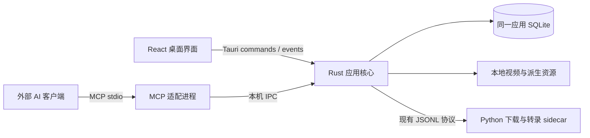

# 自媒体工作台、视频知识库与 MCP 技术方案

日期：2026-10-27。

状态：WB-001～WB-003、WB-101～WB-118 已实现，包括独立资产存储、迁移、中文检索、桌面命令、知识库列表、分类标签、资产详情、文件播放、文案阅读编辑、笔记、基础工作台和导出备份恢复核心及界面。WB-119、WB-201、WB-202 的 Windows 部分已验证；WB-203 已交付 stdio 适配与 Windows 协议 / 退出验证，WB-204 七项只读工具、WB-205 受限 Resources、WB-206 MCP 设置及配置复制和 WB-207 安装包接入均已完成 Windows 验证。WB-208 已完成 Windows 真实 Codex 客户端 / 模型对比、来源和生命周期验收。以上各项的 macOS 两种架构继续待验收，P1B 仅 Windows 限定通过；未发布本轮版本。验证见 [实施记录](workbench-knowledge-base-validation.md)。WB-301 已完成 Windows 时间来源调查；WB-302 已实现媒体 PTS 零点处理、可追溯语音段存储及备份 v2，Windows 验证通过，两项的 macOS 继续待办。WB-303 已实现片段收藏、固定文案 / 源文件引用及范围播放，schema v5 / 备份 v3 保留收藏；Windows 验证见本批记录，macOS 继续待办。WB-304 已实现指定位置 / 片段采样、关键帧资源和 Windows 验证，WB-304 交付时使用 schema v6 / 备份 v4；macOS 继续待办。详见[关键帧契约](asset-keyframes.md)。WB-305 已实现有时间原文的同步阅读、键盘及连续段落选取，Windows 验证通过，macOS 继续待办；见[同步阅读契约](transcript-sync-reading.md)。WB-306 已实现六字段文案拆解、四维度范围笔记、引用与人工 / AI 创建来源，交付时 schema v7 / 备份 v5；Windows 验证通过，macOS 继续待办，见[拆解契约](structured-analysis.md)。WB-307 已实现多选资产对照、逐结论固定来源和比较笔记，交付时 schema v8 / 备份 v6，见[比较契约](video-comparison.md)；Windows 验证及 macOS 待办以实施记录为准。WB-308 已实现研究专题和三类成员关系、增删 / 排序与缺失保留，交付时 schema v9 / 备份 v7，见[专题契约](research-topics.md)。WB-309 已实现自己的选题 / 观点 / 草稿、三类参考和工作台入口，WB-309 交付时 schema v10 / 备份 v8，见[选题契约](ideas-and-drafts.md)。WB-310 当前 schema v11 / 备份 v9，专题与草稿保存 AI 创建来源；macOS 继续待验收。本文约定产品范围、数据边界、接口方向和验收要求，具体完成情况以任务清单及实际验证为准。

实施进度见 [可勾选任务清单](workbench-knowledge-base-tasks.md)，按准备、P1A、P1B、P2、P3 的依赖关系推进；本文维护方案约定，任务清单维护执行状态。

## 1. 目标与实施范围

将“映取”从视频下载工具扩展为面向个人自媒体创作者的视频学习与创作工作台，形成“收集视频 → 整理文案 → 收藏片段 → 拆解学习 → 积累选题 → 创作复用”的流程。

知识库保存视频及对应口播文案，支持用户新建分类、一个视频加入多个分类，以及通过标签和笔记沉淀表达与制作方法。后续通过 MCP Server 向 AI 客户端提供检索、读取和受控写入能力，让 AI 基于已有资料总结、对比和整理，并将成果保存回知识库。

首阶段优先完成独立资产、分类标签、文案编辑、笔记、全文搜索、本地视频导入、知识库备份，以及 MCP 读取。片段、同步文案、视觉分析和选题工作区按后续阶段交付。

继续采用本地桌面架构。不在本轮目标中引入云同步、多用户协作、平台内容搜索、作者自动采集、自动发布、完整视频编辑器或内置通用 AI 聊天产品。外部模型的总结推理由连接的 AI 客户端承担，MCP 接口本身不要求应用保存模型 API Key。

## 2. 当前基线与必须改变的边界

以下事实依据落盘时源码，实施前仍须核对当前代码：

| 当前能力或结构 | 来源 | 升级方向 |
| --- | --- | --- |
| Tauri 2、React / TypeScript、Rust 核心、Python sidecar、SQLite | [现有技术方案](tauri-desktop-technical-plan.md)、[Cargo 清单](../src-tauri/Cargo.toml) | 复用现有架构与依赖，不新增第二套下载系统 |
| 下载任务保存在 `download_tasks`，包含任务快照 | [desktop_core.rs](../src-tauri/src/desktop_core.rs) | 新增独立资产，下载任务只记录采集过程 |
| 成功文案主要保存全文及模型、源文件信息，以 `task_id` 关联 | [transcription.rs](../src-tauri/src/transcription.rs) | 成功文案归属于资产，运行中的转录操作仍归 Rust 管理 |
| 移除历史会删除对应 `video_transcripts`，并按剩余任务引用清理封面 | [desktop_core.rs](../src-tauri/src/desktop_core.rs) | 清理下载历史保留资产、文案、笔记和资产需要的封面 |
| 文案弹窗支持查看、复制、TXT 导出与重新提取，正文只读 | [video-transcript.tsx](../src/components/video-transcript.tsx) | 知识库增加整理稿与编辑能力，保留识别原文 |

原技术方案中的“不做 MCP”属于下载器阶段边界。本文将 MCP 与知识库列为后续建设目标，其余下载引擎、凭据、取消、文件校验和分发约束继续有效。

现有转录中的完成片段计数仅表示处理进度，不等于已保存可用于跳转的句子时间戳。不得据此声明已经支持文案同步。

## 3. 信息架构与主要流程

### 3.1 应用入口

| 入口 | 职责 | 内容 |
| --- | --- | --- |
| 工作台 | 继续当前学习与创作 | 最近访问、待分类、待整理、正在处理的操作；后续增加选题进度 |
| 知识库 | 管理和检索长期资料 | 视频、分类、标签、文案、笔记；后续增加片段与专题 |
| 下载中心 | 采集和处理 | 现有链接预览、下载任务、历史及相关操作 |
| 设置 | 管理应用和连接 | 复用现有设置，增加知识库导出与 MCP 开关、连接信息 |

保留现有链接解析入口。导航调整及新页面的具体布局在实施时同步至 [DESIGN.md](../DESIGN.md)，本文不另建视觉 token。工作台以可继续的事项为主，不以统计数字替代操作入口。

### 3.2 分类、标签、专题与选题

- 分类表达内容领域，支持父子关系。一个视频可以加入多个分类，不复制或移动视频文件。
- 标签表达内容或制作特点，例如“反问开头”“故事论证”“手绘动画”。标签与分类分别维护。
- 专题是后续的研究集合，可组合多个视频、片段和笔记，例如“前五秒如何留住观众”。
- 选题是自己的创作对象，保存观点、草稿及引用，允许跨专题、跨分类使用资料。
- “待分类”由没有分类关系的在库资产计算；“未转录”由没有成功识别原文计算，不要求用户手动维护这些状态。

分类允许重命名和移动，禁止形成父子循环；同一父分类下名称唯一。删除分类只删除组织关系，不删除资产；有子分类时先移动或删除子分类。用户选择父分类筛选时默认包含其后代。标签名称去除首尾空白后不允许重复。

### 3.3 采集与学习流程

1. 新下载成功且文件提交校验通过后，自动建立或关联资产，出现在知识库“待分类”；解析失败、下载失败或仅有预览不生成资产。
2. 用户也可通过原生文件选择器导入已有本地视频。首阶段引用原文件，不默认复制大视频；探测成功并持久化后才显示入库成功。
3. 打开资产详情，播放视频、提取或阅读文案、加入分类、添加标签和笔记。正文编辑保存为整理稿，识别原文保留。
4. 后续支持选择时间段收藏片段、保存关键帧及拆解，再把参考内容加入专题和自己的选题。
5. 已有图集仍按原下载契约处理；首阶段知识库只接收视频，不伪装图集为可转录视频。

## 4. 应用架构

- Rust 继续作为任务、知识库数据、文件关系及进程生命周期的唯一权威。
- React 和 MCP 分别作为交互适配层，调用同一套资产、分类、文案、笔记服务；不得分别实现业务规则或直接写数据库。
- Python 保持现有媒体解析、下载、转录等职责，不维护知识库索引和分类。
- 知识库使用现有应用数据库中的独立表。现有下载快照和设置结构不因本功能重写。
- 新领域逻辑按资产、文案、组织关系和笔记拆分 Rust 模块；MCP 协议处理与领域服务分离，避免继续把所有逻辑追加进 `desktop_core.rs`。
- 继续使用现有命令、事件和操作状态机制，不将知识库升级为通用任务平台。

## 5. 数据模型

### 5.1 首阶段逻辑表

下表是逻辑模型，具体 DDL、索引和字段编码随实施提交；不直接以整份 JSON 快照承载需要关联、筛选或检索的所有数据。

| 实体 | 主要字段 | 约束与用途 |
| --- | --- | --- |
| `library_assets` | `id`、标题、作者快照、来源平台、作品 ID、规范来源链接、`created_at`、`updated_at`、`archived_at` | 稳定 UUID；身份不依赖下载任务；来源可为本地 |
| `asset_files` | `id`、`asset_id`、路径、大小、修改时间、媒体时长与规格、可用状态 | 同一作品可有多个下载版本；路径变化不改变资产 ID |
| `asset_task_links` | `asset_id`、`task_id`、`file_id` | 关联采集记录；移除任务只解除关系 |
| `asset_resources` | `id`、`asset_id`、类型、内容或受控存储引用 | 封面等资产资源独立于解析缓存的清理周期 |
| `library_categories` | `id`、`parent_id`、名称、排序 | 父子分类，不允许循环 |
| `asset_categories` | `asset_id`、`category_id` | 联合唯一，多对多 |
| `library_tags` / `asset_tags` | 标签 ID、名称；资产与标签关系 | 标签名称及关联分别唯一 |
| `asset_documents` | `id`、`asset_id`、`kind`、全文、版本、源文档 ID、源文件指纹、模型信息、时间 | `kind=recognized|edited`；保留成功识别版本和用户整理稿 |
| `asset_notes` | `id`、`asset_id`、类型、正文、`origin`、来源引用、修订号、时间 | 普通笔记或结构化拆解；区分人工和 AI 内容 |
| `asset_transcriptions` | `file_id`、操作状态摘要 | schema v2 按文件保存转录操作；不保存成功正文，详情从资产文档读取 |

时间统一沿用应用已有的 UTC 存储方式，界面本地化显示；分类名称等自然键不作为跨表身份。外键及关系清理在事务内执行，实施时核对并启用连接级外键约束。

### 5.2 资产身份与去重

- 已有明确平台和作品 ID 的视频，以平台作品身份归并为同一资产；不同清晰度及重复下载作为文件关联，保留各自任务记录。
- 本地导入先根据已登记文件的规范路径与实际文件身份识别重复，不为每次导入强制读取完整视频计算哈希。
- 不能确认同一作品时保留独立资产，不依赖标题、时长或作者名自动合并。跨平台相同内容及用户手动合并留待后续需求。
- 一个文件可以被多个分类视图引用；删除分类或移出分类不触及文件。

### 5.3 文案版本与引用

- 原始识别结果与人工整理稿分开保存。重新识别成功产生新的识别版本，旧版及整理稿不被覆盖。
- 编辑保存使用文档修订号；内容已被其他编辑者更新时返回冲突及当前版本，不静默覆盖。初期保存按钮完成整稿提交，不建设协同编辑系统。
- 转录失败、取消、中断或无语音时保留既有成功文案。文件缺失或变化时仍可读、复制和导出旧文案，但明确显示其对应的源文件状态。
- 笔记引用保存 `asset_id`、文档 ID / 版本、引用原文；后续增加片段 ID 和时间范围。修改文案后旧引用仍可核对，不把旧引用悄悄指向另一版本。
- AI 分析保存客户端提供的模型标识、生成时间及引用；模型标识未知时留空，不冒用当前安装的转录模型。

### 5.4 后续实体

WB-302 的 schema v4 已增加 `transcript_timings` / `transcript_segments`，包含不可变文档及文件绑定、操作 ID、采样帧数、VAD 修订、顺序、起止和正文；识别文档保留模型 / pipeline / Source 指纹。WB-303 的 schema v5 已增加 `asset_clips`，保存起止、标题 / 理由、源指纹及不可变文案引用。WB-304 的 schema v6 已增加 `asset_keyframes`，保存可选片段绑定、来源指纹、采样元数据和 PNG BLOB；WB-306 的 schema v7 增加与原笔记关联的 `note_analyses`（WB-307 的 schema v8 另增 `note_comparisons`） JSON，保存文案模板、制作观察和不可变资源引用快照，正文投影与结构事务一致；WB-308 的 schema v9 增加 research_topics / research_topic_members；WB-309 的 schema v10 增加 library_ideas / idea_references，自己的正文与参考资料分开保存，片段默认引用原文件，不另行裁剪。

时间仍采用 FSMN-VAD 语音段级范围：CPU 复用固定 CLI `--srt`，CUDA 保留现有区间 / 正文映射；10ms 网格不代表句子或逐字精度。媒体坐标保留 PTS 零点，正延迟补静音，负 PTS 裁掉，不减去第一包 / 容器起点。段落、文档和操作同一事务保存，整理稿不继承，旧结果无时间；当前备份 writer v9 / reader v1、v2、v3、v4、v5、v6、v7、v8、v9，保留时间、片段引用及关键帧图片，见[片段契约](asset-clips.md)。当前契约及 Windows / macOS 边界见 [可追溯段落](transcript-segments.md)，原选型证据见 [时间来源验证](transcript-timing-validation.md)。

## 6. 文件、移除和资源生命周期

| 操作 | 数据与文件行为 |
| --- | --- |
| 移出某个分类 / 删除标签 | 只改变对应关系 |
| 移除下载记录 / 清理历史 | 删除任务及临时操作记录，保留资产、文案、笔记、分类与文件 |
| 移出知识库 | 设置 `archived_at`，默认列表与检索不再显示；保留资料与文件，允许恢复 |
| 明确删除本地视频 | 沿用现有文件删除机制；关联文件标记缺失，知识库文案、笔记及引用保留 |
| 文件被外部移动或删除 | 显示缺失，保留资料，允许通过文件选择器重新关联 |
| 永久删除知识资料 | 首阶段不提供；后续单独定义关联片段、专题和选题引用的处理 |

已有下载中心删除文件后是否移除任务的行为继续依照现行契约；新增要求是不能连带删除独立的知识库内容。修改前核对现有 [设计规范](../DESIGN.md) 和真实调用路径，并在实施时同步具体文案。

封面入库时转成知识库拥有的资源或建立可靠的资源引用；不得只引用会随历史清理释放的解析缓存。关键帧等可再生资源与视频原文件分开管理，不以清理缓存名义删除用户视频。

## 7. 转录、播放与检索

### 7.1 转录与播放

- 复用现有 Fun-ASR-Nano CPU / Windows CUDA、FFmpeg 检测、取消及失败传播；首阶段仍一次执行一个转录操作，不提高并发。
- 转录入口逐步从 `task_id` 过渡为 `asset_id` + `file_id`，兼容过渡仅覆盖仍使用旧任务入口的现有界面；成功结果只有资产文档一份权威数据。
- 当前核心与原生命令已完成上述入口切换；旧任务接口通过文件关联适配，新导入视频无需下载记录即可转录。新页面仍按后续任务交付。
- 本地导入和重新关联复用 sidecar 的 `probe_local_video`，仅支持 MP4 / MOV / MKV / WebM，本机 FFprobe 只启用文件协议及对应容器；探测失败、取消或文件指纹变化不提交资料或关联。
- 首阶段全文可用即交付，不用平均分配字数伪造句子时间戳。旧文案允许“无时间信息”。
- 第二阶段验证现有 VAD / ASR 输出能否形成真实分段时间，必要时单独评估对齐能力；准确度不足时只能标注段落级范围，不能声明逐字同步。
- 同步界面支持点击段落跳转、播放定位、关闭自动滚动、键盘播放和片段范围播放。无时间信息的文案仍可正常阅读。
- 本地播放器先验证现有容器与编码在 Windows WebView2、macOS WebKit 的兼容性；无法内嵌播放时提供打开本地文件的入口，不自动转码。相关限制逐平台记录。

### 7.2 检索

首阶段使用 SQLite 参数化查询，对标题、作者、识别原文、整理稿和笔记进行中文子串检索，组合分类、标签、来源平台与文件状态筛选。分类和标签通过关系索引查询，结果使用入库时间及稳定 ID 的键集游标分页。多个分类包含后代并按 OR 匹配，多个标签按 AND 匹配；文件状态在分页前检查，避免筛选后形成空页或漏页。

返回资产摘要、命中字段、至多 120 字符的命中片段、对应文档及版本。保留的历史文案版本也可命中，结果明确引用其版本；默认排除已移出知识库的资产。使用 `instr` 字面子串匹配，包含 `%`、`_` 等字符的查询不作为 SQL 通配语法。前端、领域服务和全部桌面命令的参数、全文读取及变更事件见 [API 契约](workbench-knowledge-base-api.md)。

在实际规模下评估延迟后再决定全文索引。若需要 FTS5，先确认 bundled SQLite 的能力和中文分词策略；默认 `unicode61` 不作为中文词语检索充分性的依据。语义搜索、嵌入模型和向量库不进入首阶段依赖。

## 8. MCP 设计

### 8.1 角色、连接与运行方式

应用提供 MCP Server，外部 AI 客户端负责模型推理。MCP 适配层只暴露明确的领域操作，不暴露任意 SQL、文件路径读取或 shell 执行。

首版本机连接采用“stdio 适配进程 → 本机 IPC → 正在运行的应用核心”。Windows 使用命名管道，macOS 使用 Unix domain socket；端点限制到当前操作系统用户。适配进程不另开数据库连接承担写入，也不启动第二套下载或转录调度器。WB-202 已交付 Core 持有的默认关闭 IPC、状态与启停命令，Windows 管道和跨进程验证通过，macOS 编译及运行继续待验收；端点、权限、内部协议 v1 与白名单见 [本机 IPC 契约](mcp-local-ipc.md)。

MCP 默认关闭，用户开启后可复制客户端启动配置。WB-206 已接入 MCP 设置分类、真实启停状态、原生复制及实际程序目录生成的 Codex TOML / 通用 JSON；WB-207 已将原生适配程序和完整许可纳入安装包，Windows 中文空格安装目录、配置启动与读取已验证，macOS 两种架构继续待办，详见 [MCP 设置](mcp-settings.md)与[安装包分发](mcp-packaging.md)。应用未启动或服务未开启时明确返回不可用，不后台隐式启动应用。单实例及退出流程沿用现有应用机制；退出时结束 IPC 服务，适配进程处理断连，不声称仍可继续访问。

本阶段不开放 HTTP 监听和公网连接。云端 AI 客户端不能直接访问本机 stdio；远程连接须另行设计传输、认证及数据授权，不将其当作本地 MCP 已支持的能力。

WB-201 已选定 [官方 Rust SDK](https://github.com/modelcontextprotocol/rust-sdk) `rmcp = 3.8.0`，crate 声明 Apache-2.0、最低 Rust 1.88，采用 `server` / `macros` / `transport-io` 最小 feature。Windows 已通过 2026-07-28 discovery / 请求元数据及旧 2025-11-25 initialize 的 stdio 互通验证，目标本机客户端 Codex CLI 0.162.1 已发现样例工具。SDK 负责两种生命周期，不自行实现完整 MCP 协议栈；版本、来源、许可证、复验与 macOS 待办见 [SDK 选型验证](mcp-sdk-validation.md)。SDK probe 仍为独立合成样例；WB-202 已实现应用侧 IPC，WB-203 已实现可选 mcp feature 的独立 stdio 入口和分类 / 标签映射，Windows 验证通过、macOS 待验收，见 [适配进程契约](mcp-stdio-adapter.md)。WB-204 已完成七项只读工具的 Schema、领域服务、分页、版本 / 修订引用和 Unicode 读取边界，Windows 验证通过、macOS 待验收，见 [只读工具契约](mcp-read-tools.md)。WB-205 已实现与工具相同范围的资产 / 文档 / 笔记 Resources，Windows 验证通过、macOS 待验收，见 [资源契约](mcp-resources.md)。WB-206 的设置、WB-207 的安装包和 WB-208 的真实客户端组合均已完成 Windows 验证，见 [真实客户端验收](mcp-client-acceptance.md)；macOS 两种架构继续待办。

### 8.2 分阶段工具契约

P1B 七项工具已使用 JSON Schema 固化并通过 Windows 契约测试，具体字段与边界以 [只读工具契约](mcp-read-tools.md)为准；WB-310 的六项新增写工具及 WB-311 的三项转录控制 / 查询已实现，默认只读且需桌面授权，准确字段以[受控写入](mcp-write-tools.md)为准。长操作准确字段及生命周期以[转录长操作](mcp-transcription-operations.md)为准；WB-312 的片段、已有 PNG 与可选模板已实现，字段和真实客户端支持范围见[媒体契约](mcp-media-tools.md)。大图交付使用有明确标记和实际尺寸的临时缩小预览，保存的原 PNG、原尺寸、PTS 和采样绑定不变。写授权不影响这些只读工具，且不自动授予模型或上传权限。

| 工具 | 主要输入 | 输出 / 行为 | 阶段 |
| --- | --- | --- | --- |
| `search_assets` | `query`、分类 / 标签 / 平台筛选、`cursor`、`limit` | 摘要、命中片段、稳定资产 ID、下一页游标 | P1B |
| `get_asset` | `asset_id` | 元数据、文件可用性、文档与笔记摘要 | P1B |
| `read_transcript` | `asset_id`、可选 `document_id`、`offset`、`length` | 指定版本正文切片、总长度、下一位置、引用信息 | P1B |
| `list_categories` / `list_tags` | 可选筛选、分页 | 分类树 / 标签及真实数量 | P1B |
| `list_notes` / `read_note` | `asset_id` 或 `note_id`、分页 / 正文范围 | 人工及 AI 笔记、修订号、来源引用 | P1B |
| `create_note` | `asset_id`、正文、模型名称与来源引用 | 新笔记 ID 与 AI 来源，不覆盖已有笔记 | P2 |
| `create_category` / `add_asset_categories` / `add_asset_tags` | 明确的名称或稳定 ID | 创建分类或增加关系；重复关联无副作用 | P2 |
| `start_transcription` / `get_operation` / `cancel_operation` | 资产 / 文件 ID，或操作 ID | 复用现有长操作，报告真实状态与取消结果 | P2 |
| `get_clip` / `get_keyframes` | asset_id、可选片段 / 文件 ID、范围及分页 | 固定片段引用、已有 PNG、原始 PTS 和采样说明；不提供视频 / 音频字节 | P2 |
| `create_topic` / `create_idea` | 标题、正文、参考资产 / 片段 | 新专题或选题 ID | P2 |

首期检索和列表 `limit` 默认 20、上限 100；全文每次默认读取 4,000 个 Unicode 字符、上限 16,000 个字符，返回实际范围及是否结束。跨端字符位置统一按 Unicode 标量计数，不混用字节和 JavaScript UTF-16 索引。

检索结果可随后发生更新，读取和写回引用始终带文档版本。工具结果不返回 Cookie、代理凭据、签名媒体地址、任意本地绝对路径或整个设置快照。正文和笔记是待分析资料，不作为工具执行指令。

### 8.3 Resources、Prompts 与写回

- WB-205 已用稳定 URI 表达资产摘要、文案版本和笔记，例如 `yingqu://assets/{asset_id}/documents/{document_id}`，提供三个静态模板与 JSON 文本读取；不枚举全库或开启订阅。读取直接复用工具的类型化适配及 Core，保留分页、归属、版本 / 修订和 Unicode 范围，见 [资源契约](mcp-resources.md)。
- 以 Tools 检索和读取为兼容基线；客户端不支持 Resources 或 Prompts 时核心流程仍可完成。
- WB-312 Prompts 已提供“文案结构拆解”“同题视频对比”“制作手法观察”三个可选模板，要求引用来源、记录实际采样，区分资料事实、观察及建议。模板不固化模型或供应商，也不自动读取 / 上传资料；Tools 流程独立可用。
- AI 总结以新笔记保存；默认不覆盖识别原文、整理稿或人工笔记。写操作单独开启，桌面界面能看到 AI 来源、生成时间和引用。
- 结构化拆解先覆盖开头、观点、论据、转折、结尾和可借鉴点；视觉拆解另含画面、转场、字幕、声音及对应时间范围。
- 长操作返回操作 ID 后查询状态，取消复用现有机制；模型请求超时不等于底层转录已停止，不自动重复启动相同操作。
- P1B 仅开放读取；P2 首批写入只涵盖笔记、添加组织关系和创建草稿，不开放文件删除、清空知识库或平台凭据修改。

### 8.4 模型与数据边界

读取口播全文只能支持文本结构分析。视频制作手法分析必须实际提供画面或片段，并保存所分析的时间范围与采样信息；仅看关键帧不能声称已检查全部转场、声音和连续运动。

连接的客户端能否接收图片、视频或音频分别验证，不把模型支持多模态等同于 MCP 客户端具备全部媒体能力。未具备相应能力时明确标记分析范围。

开启 MCP 时说明所开放的数据范围：外部 AI 客户端可能将读取内容提交给其模型服务。本地存储和本地 ASR 不代表外部 AI 推理也在本机完成。首阶段不由应用自动上传全库或自动定时分析。

## 9. 历史数据迁移

1. 增加显式知识库 schema 版本和可重复检查的迁移记录，在执行前生成本地数据库一致性备份；该备份可能包含既有设置与凭据，仅用于本机升级恢复，不作为对外导出包。
2. 为已有已完成视频任务建立资产和文件关联，同平台作品归并，保留不同文件版本。图集、失败任务和只有预览的记录不伪造为视频资产。
3. 有历史成功文案但源文件缺失的记录仍建立资产并迁移正文；没有可靠来源身份时保留独立资产。保留模型、后端、时间和源文件指纹，不补造时间戳。
4. 迁移资产需要的封面，验证清理历史不会释放其唯一封面来源。外部视频不移动、不重命名、不重新下载或转录。
5. 持久化旧任务到资产的映射。数据迁移与映射提交在同一事务中，重复执行不重复创建资产；失败时回滚并报告，不绕过失败启动可写的新模式。
6. 新旧入口切换后，成功文案仅由资产文档表管理，任务相关状态只保留操作信息；不长期双写两套正文。
7. 降级到不认识新 schema 的版本不支持直接打开升级后的库；需要先退出应用，再按升级恢复流程恢复旧库。知识库写入后的成果另行导出，不声称旧库备份包含新增资料。

历史数据只能迁移仍然存在的记录和文案，已被旧版本清理的内容不能凭视频标题恢复。

## 10. 备份、导出与恢复

- 沿用单篇 TXT 导出，新增整理稿及笔记的 Markdown / JSON 导出，包含可追溯的来源信息。
- 知识库备份采用带格式版本的逻辑包：资产、分类标签、文案版本、笔记、关系、封面及文件引用清单；不直接导出包含设置和 Cookie 的整个应用数据库。
- 默认不包含视频大文件，明确标记“仅资料备份”。完整备份由用户主动选择是否包含视频；包内使用相对路径并登记文件大小和完整性信息，不把原始绝对路径作为可跨设备恢复的保证。
- 首阶段逻辑包恢复面向空知识库，保留资产与引用 ID；已有资料时拒绝直接覆盖，增量合并不进入首阶段。
- 恢复先校验包版本、清单、文件和关系，再事务导入。缺少原视频时可恢复文案和笔记，并提示重新关联；包内路径不得跳出用户选择的恢复目录。
- 数据库升级前的本机备份、可迁移的知识库逻辑包、单篇内容导出分别标注用途，不以任意一种替代其他能力。
- WB-117 已实现 Rust Core 的 TXT / Markdown / JSON 单篇文稿及笔记导出、目录包格式 v1 和空库事务恢复，使用现有 serde / tempfile / SHA-256，未新增依赖；目录结构、完整性校验、媒体来源映射与错误见 [核心契约](workbench-knowledge-base-api.md#6-单篇导出与逻辑包核心wb-117)。WB-118 已接入界面、选择器及原生异步生命周期；真实 GUI 与平台验收按阶段单独记录。

## 11. 分阶段交付与验收

### P1A：独立知识库基础

交付独立资产和历史迁移、多分类、标签、原生本地视频导入、文案原文 / 整理稿、笔记、中文全文搜索、基础工作台、逻辑备份恢复和原文 / 整理稿导出。复用现有单转录并发，不要求文案时间同步。

必须验证：

- 同一视频加入多个分类不复制文件，父分类筛选包含后代；分类、标签和批量关联重启后恢复。
- 清空下载历史后仍可打开在库资产、封面、文案和笔记；删除本地视频后保留文本并准确显示缺失。
- 旧成功文案、缺失源文件、重复作品、多文件版本和图集混合数据迁移正确；重复迁移不增殖，失败无半成品。
- 编辑、重新识别、失败和取消不覆盖已有整理稿；重新关联源文件后明确显示旧文案来源差异。
- 中文短词、特殊字符、跨文案及笔记检索有效，筛选与分页结果正确。记录实际数据量、全文体量和延迟，依据可接受的真实使用体验判断是否需要索引升级。
- 备份包不含应用设置与凭据；空库恢复后数量、正文、分类关系及来源引用一致，缺媒体场景可用。

### P1B：MCP 只读接入

交付本机连接、启停设置、客户端配置、检索、文案和笔记读取。外部 AI 可总结资料；本阶段结果由用户手动保存，应用尚不支持 MCP 自动写回。

必须验证：

- 至少一个明确记录名称与版本的真实本机 AI 客户端完成“筛选视频 → 读取正文 → 对比总结 → 引用来源”流程。
- 应用关闭、服务关闭、断连、空结果、未知 ID、越界分页和超限读取均有明确结果。
- 所有读取按已定义范围返回，不泄露设置、凭据或本地路径；不存在 MCP 直接写库路径。
- 自动协议测试、真实客户端接入、AI 总结质量分别记录，不互相替代。

### P2：拆解学习与创作复用

交付真实文案分段时间、片段收藏与播放、关键帧、结构化拆解、跨视频对比、专题、选题草稿，以及受控 MCP 写回和转录操作。

验收覆盖引用能回到正确版本和时间范围、长短视频时间对齐、横竖视频及编码差异、AI 笔记与人工内容分离、客户端实际多模态能力、取消及资源回收。无法获得可靠时间或媒体能力时保留已验证范围，不用推测结果代替实现。

### P3：持续创作辅助

根据真实使用反馈再评估语义搜索、相似片段、作者研究、智能视图、制作资料导出及作品发布后的人工复盘。向量索引、远程 MCP、自动分析和第三方制作工具连接分别立项，不默认纳入前两阶段。

### 验证执行规则

实施命令以 [开发文档](development.md)、`package.json` 和 CI 为准。Rust 领域逻辑、迁移及 MCP 契约使用隔离数据库和 fixture；UI 运行现有类型 / 构建检查，并在 `DESIGN.md` 规定的 1440 × 900、1280 × 800、1024 × 680 验证键盘、长文案、长标题和文件缺失。

浏览器预览、Windows 原生、macOS Intel、macOS Apple Silicon、真实 MCP 客户端与安装包分开记录。未执行项标记 `NOT_RUN` 或 `UNAVAILABLE`；纯文档落盘不触发产品功能验收，也不改变现有发布版本。

## 12. 参考案例与协议来源

以下资料用于说明产品和协议设计依据，不表示已接入这些产品、支持其所有能力或采用其实现代码。

- [Eagle：多文件夹引用、标签与智能文件夹](https://en.eagle.cool/blog/post/ember-alternative)：借鉴一个素材多处归类且不复制文件的组织方式。
- [Readwise Reader：YouTube Videos](https://docs.readwise.io/reader/docs/faqs/videos)：借鉴同步文案、文字跳转、划线和笔记，保留文案版本变化对引用的影响。
- [Milanote：影视制作模板](https://milanote.com/templates/filmmaking)：借鉴参考资料、脚本、视觉方向和分镜围绕创作组织的方式。
- [Google：NotebookLM 音频与 YouTube 来源](https://blog.google/innovation-and-ai/products/notebooklm-audio-video-sources/)：借鉴基于资料的总结、跨来源比较和引用核对；不据此推断转录文本可覆盖视频画面分析。
- [MCP：服务端核心概念](https://modelcontextprotocol.io/docs/learn/server-concepts)：Tools、Resources、Prompts 的职责依据；具体稳定版本和客户端支持在实施时核验。
- [MCP 官方 Rust SDK](https://github.com/modelcontextprotocol/rust-sdk)：实施阶段优先评估的协议依赖，最终选型需记录版本、许可证、兼容性和打包结果。
