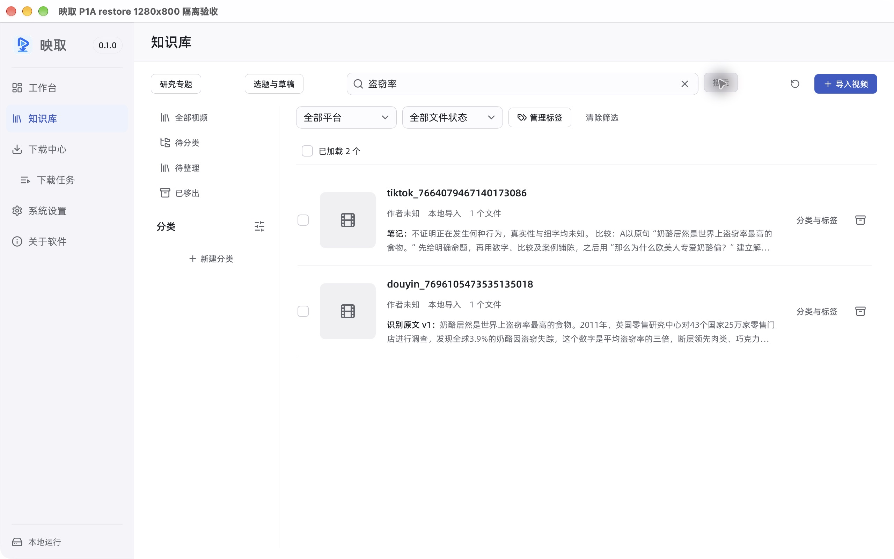
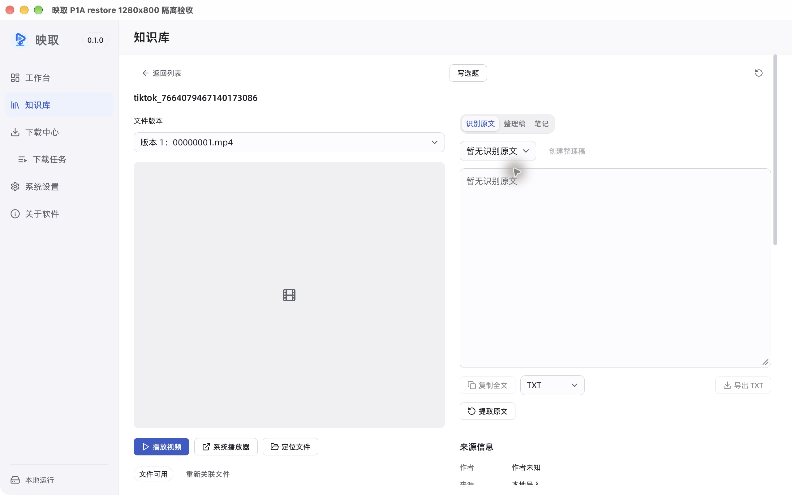
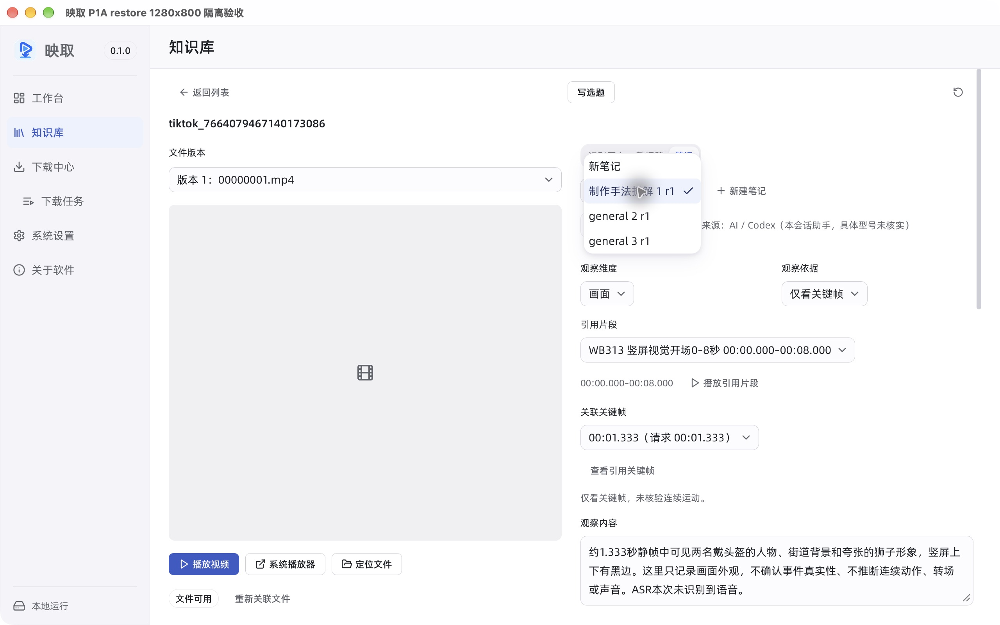
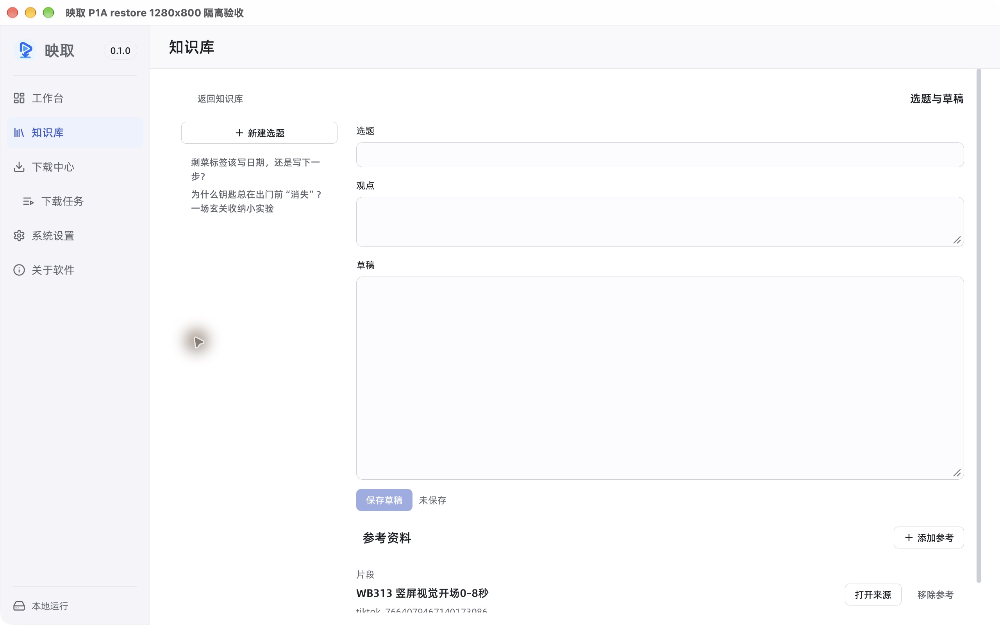
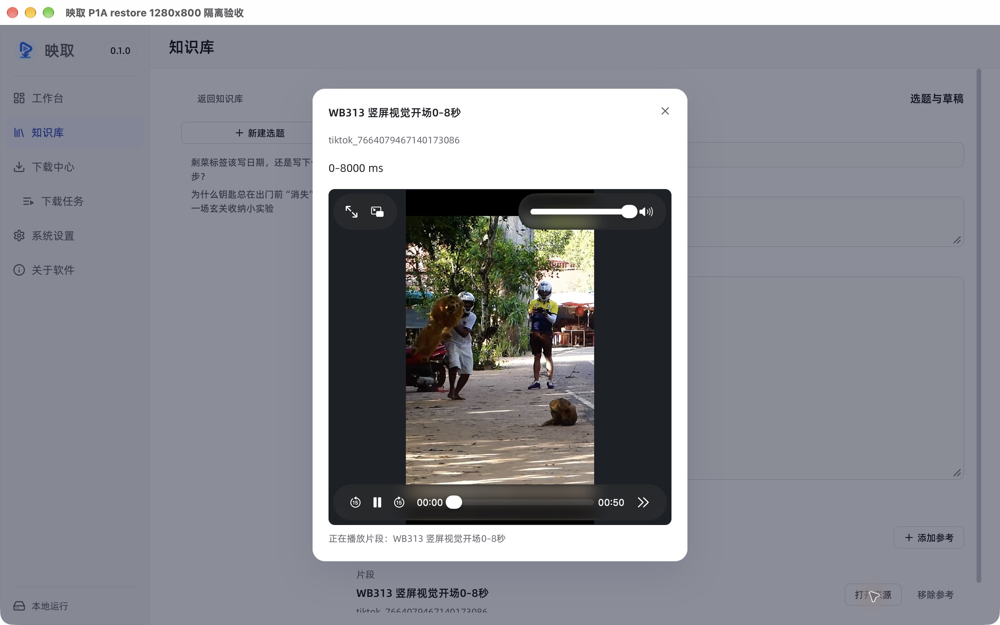
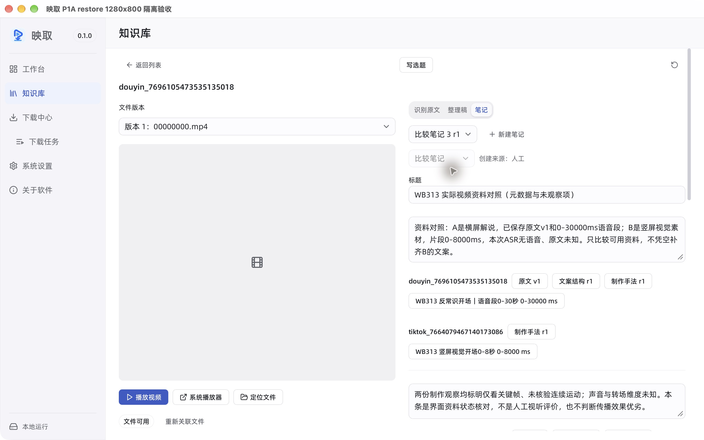
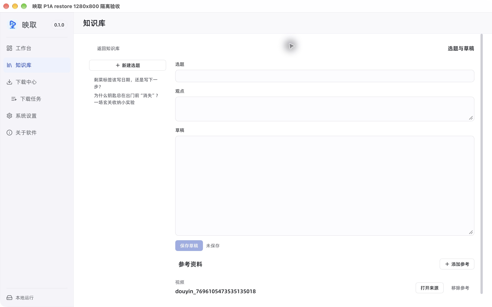
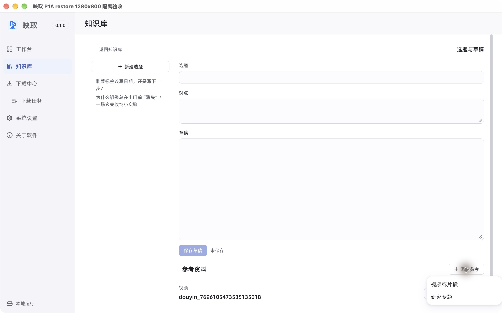

# WB-401：真实使用问题与优先级评估

状态：**评估完成，功能未开发**。日期：2026-10-29。范围：本机 macOS Apple Silicon、1280×800 原生 Tauri / WKWebView；`master / a029b9816cbd9299ed92b549edb3e6efb0a71e39` 加既有未提交工作区。

首要需求是**看过参考后，帮助用户提炼自己的选题和观点**。用户本轮先回答“选题”，随后明确“看过参考后，仍难提炼自己的选题和观点”。这是真实用户反馈；没有提供发生次数、耗时或具体选题案例，不能替用户补写这些事实。搜索跳转、笔记辨认及比较转接是本轮实际操作发现的摩擦，不能据此认定它们就是创作困难的根因。

## 1. 方法、样本与完成边界

- 使用 WB-313 的含媒体恢复隔离库 `macos-b41-final-media / restore`，其中有两份实际视频、1篇识别原文、2片段、6张保存图片、8笔记和2选题。数量仅描述样本，不是使用效果指标。
- 本轮重新执行四个实际任务，保存并逐张检查原生截图及可访问性树；没有复用旧截图作为本轮审查证据。没有新调模型、使用账号或上传资料。
- 用户反馈、现场操作、代码契约和历史上下文分开。操作由执行助手完成，属于真实资料上的流程观察，**不是多用户可用性研究，也不是用户亲自操作计时**。
- 只读查看已有资料，片段和视频实际可播放；两次临时引用草稿均通过离开保护明确放弃，没有保存新资料。十张业务内容表前后相等，正常访问记录可能变化，不声称整个 SQLite 文件字节不变。
- 当前操作证据位于 `.local/macos-workbench-20261029-b42/`；下文八张截图以原始 JPEG 原样保留在 `docs/assets/wb401/`，与已检查的本轮截图逐字节相同。旧的 WB-313 组合验收只作为[前置背景](workbench-knowledge-base-validation.md#第-41-批wb-313-真实视频学习到创作组合验收)。

本项依用户明确要求，在已完成 WB-313 Apple Silicon 子项的基础上开展；不关闭 WB-313 尚未完成的 Windows / Intel 验收。

## 2. 优先级与取舍

排序依据依次为：用户明确的核心阻力、任务影响、已有证据的重复程度，以及完成最小方案的成本。不同的小分母不能直接比较发生率。P1表示优先验证或安排，P2表示其后改进；本轮没有发现可定为P0的数据丢失问题。工期为基于现有代码的粗估人日，包含设计、实现及定向验证，**不是已批准排期**；效果仍需验证。

| 顺序 / 编号 | 问题与证据 | 本轮频率及影响 | 最小建议与估算成本 | 可观察验证目标 |
| --- | --- | --- | --- | --- |
| 1 / P1 / U-01 | 从参考到独立选题、观点缺少提炼引导。用户明确反馈；步骤3、4的编辑页仅提供选题 / 观点 / 草稿及参考 | 1位用户明确提出；日常频率和耗时未知。直接影响能否开始原创，证据不足以判断需要哪种AI方案 | **先验证简短提问引导**，复用已有观点、草稿区；0.5～1人日准备与小样验证，暂不做模型接入或新持久化字段。有效后再估产品实现 | 同等参考下，用户能说明要回答的问题、自己的立场、与来源的差异及下一步核验，并确认愿意继续写；记录有效编辑用时和外部帮助次数 |
| 2 / P1 / O-01 | 笔记搜索已命中，打开却进入识别原文页。步骤1，两次进入B都落在无原文页面 | 2次已记录的笔记命中进入 / 2次均未定位命中笔记；只有1个视频对象。需要切换资料类型并找笔记，打断找回参考 | 将已有 hit.note_id / document_id / version 传入详情并定位正确资料；约1～2人日，无需先新增索引 | 从每条命中结果一次操作进入相应笔记或固定文案版本；不再手动遍历选择器；不可读时明确提示 |
| 3 / P2 / O-02 | AI通用笔记显示 `general 2 r1` / `general 3 r1`，选择前难辨内容及来源。步骤2 | B的两条通用笔记 / 两条均如此；为找回命中，实际打开两条候选正文。日常整理时间未知 | 把 general 映射为中文，选择项优先显示现有模型名、来源及时间，保留修订；约0.5～1人日。现有摘要已含这些字段，不逐条拉全文、不新增标题表 | 本样本两条不同模型来源的笔记在展开选择器时即可区分；保留AI / 人工及修订信息。大量同模型笔记是否还需摘要，待新证据 |
| 4 / P2 / O-03 | 已保存双视频比较处的“写选题”只带入所属A视频；没有带入B或比较笔记。步骤4 | 1次保存比较上下文转接 / 1次；比较本身仍在，**没有资料被删除**。用户要重新补参考，可能误以为已带入全部上下文 | 先区分“从本视频写选题”和“从当前比较继续”；最小快捷入口复用现有视频 / 片段参考，约1～2人日。直接新增“笔记”参考种类需单独设计，不混入首版 | 从当前比较继续时，明确显示A、B两个来源，并能回看学习依据；自己的观点、草稿仍独立，不自动冒充已写好的原创结论 |

O-03不是用户对“难形成观点”的直接解释，因此排在核心提炼需求之后；O-02成本较低且可直接减轻已观察到的整理辨认负担。U-01的效果尚未验证，不以“加一个AI按钮”作为已确定方案。

### U-01 的低成本验证内容

先用现有资料和原编辑区试用以下短提问，不强制增加表单字段：

1. 这条参考有什么未回答、与你的经验不同，或值得进一步验证的问题？
2. 你希望为谁回答其中哪一个问题？你的立场与参考有什么具体差异？
3. 你能用什么一手观察、反例或小实验支撑它？哪些来源说法仍待核实？
4. 把它写成一个选题和一句自己的观点，再决定是否展开成草稿。

这是**待验证的引导样本**，并未在产品中上线，也未证明有效。回访先记录用户在无引导条件下的基线，再使用同等难度资料比较；有效编辑时间排除观看视频、ASR等待、截图、调试及沟通等待。合格结果应有明确问题、独立立场、来源差异和可执行核验，不用收藏数、生成题目数或字数判断质量。用户愿意继续写，比模型一次生成很多标题更能说明是否解决问题。

## 3. 四步实际流程与截图

### 步骤1：找回参考——可命中，定位仍绕路

任务：用已知原文关键词“盗窃率”找回参考，再用已保存片段标题中的“竖屏视觉开场”找回其学习资料。

两次查询都实际返回A、B。第一条查询的B命中的是笔记中对A的比较引用，第二条查询能从制作拆解及比较笔记投影找到片段名称；这些是有上下文的文本命中，**不能把它们误报为搜索不到片段，也不能把跨来源笔记视为错误结果**。列表已显示“笔记”或“识别原文 v1”和正文摘录，这是现有优点。

从第一条查询点击B标题后，选中“识别原文”，显示“暂无识别原文”；第二次查询后再次进入B同样如此。实际命中笔记未被打开。已知真实命中词不在B原文，而在B的比较笔记中，因此需要再切到笔记及选择条目。此处只记录本轮两次进入，不外推为所有用户或所有搜索的100%失败率。

建议对应O-01。未来验证应区分“是否找到正确资料”和“是否直接到达命中内容”；本轮没有做检索延迟、海量库或语义命中基准，不据此选全文索引或向量库。

### 步骤2：整理及辨认已有笔记——内容可读，选择成本可见

任务：在B的三条笔记中找到搜索所命中的模型分析。切换笔记后先显示制作手法拆解；选择器中的两条AI通用笔记为 `general 2 r1` 和 `general 3 r1`。本轮实际打开两条候选正文才完成辨认，最终模型笔记为第3条，创建来源明确显示 gpt-6.1-sol。

这是O-02的直接证据。现有正文页保留模型 / 人工来源及修订，不应为了缩短选择列表而丢掉这些信息。当前整理负担可以描述为额外切换一个资料页、展开选择器并读取两条候选；**没有记录用户日常整理分钟数，不能宣称将节省某个百分比**。

### 步骤3：片段复用——已有路径可用，原创区保持独立

任务：从B的收藏片段点击“用于选题”，再回看引用。一次点击即在未保存新草稿中预选正确片段，选题、观点和正文为空，原资料没有被复制成自己的观点。这符合现有[创作分区契约](ideas-and-drafts.md)，空白本身不是保存或引用故障；结合用户反馈，可将其作为U-01提炼引导的试验位置。

“打开来源”实际播放固定0–8000ms片段，结束时为8秒、Play状态并显示“片段播放完成”。Escape可关闭来源，焦点回到草稿容器；本轮没有验证按钮级焦点恢复的所有键盘顺序，不据此宣称完整可访问性通过。两次临时草稿均明确放弃，没有新增选题。

A的收藏理由和原文明确标记30秒语音段跨句、末尾切词；本轮未试听并重新标定A末尾，不能把该引用称为可直接导出的逐字剪辑。继续使用现有手动范围和来源说明；若实际制作需要精剪或向编辑器导出，作为WB-404的评估输入，不据此自动建设剪辑器。

### 步骤4：从比较形成选题——来源可核对，转接上下文不足

任务：重新打开两视频对比工作区，再回读已保存的比较笔记，从该上下文进入原创草稿。比较工作区能并列原文、拆解与片段；B没有识别原文时明确“未知”，不补造文案。已保存比较能看到标题、两条结论和各自固定来源，原比较并未丢失。

在此页面点击“写选题”后，草稿只预选所属A视频，没有B或比较笔记。页面按钮当前是视频级入口，和代码契约一致；这是O-03的衔接缺口，不能描述成已有比较资料丢失或引用保存失败。

“添加参考”实际只有“视频或片段”“研究专题”，没有直接选择笔记的菜单。现有[研究专题](research-topics.md)允许收录笔记，并可作为选题参考，这是可行的契约层绕行；本轮没有新建专题并完整复跑这条替代路径，不冒充已验证的操作收益。若要新增笔记引用种类，需另评关系、固定修订和备份兼容，不在WB-401中修改数据契约。

用户反馈的重点是“提炼自己的观点”，本次不把自动带入比较结论等同于解决该问题。更直接的验证是U-01的引导是否让用户形成愿意继续写的独立选题，而非仅让参考列表更长。

## 4. 实施成本的代码依据

本轮只读结构核对，不实施改动。代码位置以本次工作区为准：

| 事项 | 当前依据 | 对估算的影响 |
| --- | --- | --- |
| 搜索命中定位 | [搜索服务](../src-tauri/src/library/search.rs)已返回note_id、document_id及version；[列表入口](../src/components/knowledge-library.tsx) openDetail只接资产ID；[文稿状态](../src/hooks/use-library-writing.ts)默认选择识别原文 | 优先改内部入口与选中状态，不需要先改SQL索引或数据库结构 |
| 笔记名称 | [笔记界面](../src/components/library-writing.tsx) noteNames缺少general，选择项只有类型、序号和修订；[LibraryNoteSummary](../src/lib/library-api.ts)已有origin、model_name及时间 | 可先用现有数据改善辨认，不逐条读全文、不创建新持久化标题字段 |
| 比较与选题衔接 | [详情入口](../src/components/library-asset-detail.tsx)“写选题”明确预选video；[选题组件](../src/components/library-ideas.tsx)及IdeaReferenceKind只支持video / clip / topic | 两视频参考快捷入口与新增笔记引用不是同一成本；后者不能按一个按钮估价 |
| 选题提炼引导 | 当前选题、观点、草稿分区已存在，主写作与参考独立 | 先做内容引导试验即可，不能凭用户一句反馈就选定自动模型分析或新增后台任务 |

## 5. 暂不立项与证据限制

| 项目 | 当前决定与理由 | 后续可观察条件 |
| --- | --- | --- |
| 全文 / 语义 / 相似检索（WB-402） | 保持待评估；两次实际查询均有文本命中，当前首要摩擦是命中后的落点 | 获得有代表性的真实查询、相关结果标注和现有延迟基线后，比较命中与性能差异 |
| 作者研究 / 智能视图（WB-403） | 本轮两份本地导入资料作者未知；不自动补造或采集作者元数据 | 出现明确作者研究任务及可获得的合法元数据后独立评估 |
| 精剪 / 制作工具连接（WB-404） | 当前片段复用与范围播放可用；未验证导出成片 | 用户给出目标编辑器和实际制作步骤，再验证可消费格式与时间粒度 |
| 发布后复盘（WB-405） | 本轮没有作品发布和表现数据 | 自己作品、原选题和实际人工表现数据可关联时再评，不用参考播放量替代制作效果 |
| 远程MCP / 自动分析（WB-406） | 本轮不启动；选题困难不能直接证明需要远程服务或自动上传 | 先验证提炼引导；确有模型辅助需求时分别确认触发、数据、费用、取消、来源与结果归属 |

本轮未覆盖：多用户、日常任务频率、用户有效编辑计时、长期创作产出、完整VoiceOver / 对比度 / 键盘矩阵、其他视口、Windows、Intel及正式安装包。截图只能证明所见状态，不能证明思考质量、传播效果或完整WCAG合规。可见焦点、Escape关闭和具名控件只是局部观察。

三次滚动截图没有到达比较操作区，已在本地steps.json标记拒收；随后通过聚焦标题字段取得正确画面。它们不计为产品故障、用户操作次数或有效编辑耗时。没有把工具启动、构建、账号授权或锁屏等待当作用户整理时间。

## 6. 完成判据与下一步

WB-401已交付用户原话、四步当前操作证据、优先级 / 成本 / 目标、明确的暂不立项决定及证据限制；[任务清单](workbench-knowledge-base-tasks.md)勾选仅表示评估完成。没有修改生产代码、DESIGN.md或备份格式，没有将上述建议宣称为已有功能。

建议下一步先与用户验证U-01的短提问引导是否帮助形成独立选题，再决定产品实现范围；已确认的O-01命中定位和O-02辨认问题可作为单独的小范围改进候选，不自动在本次实现。
